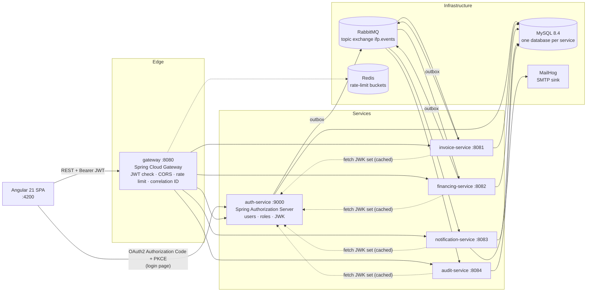
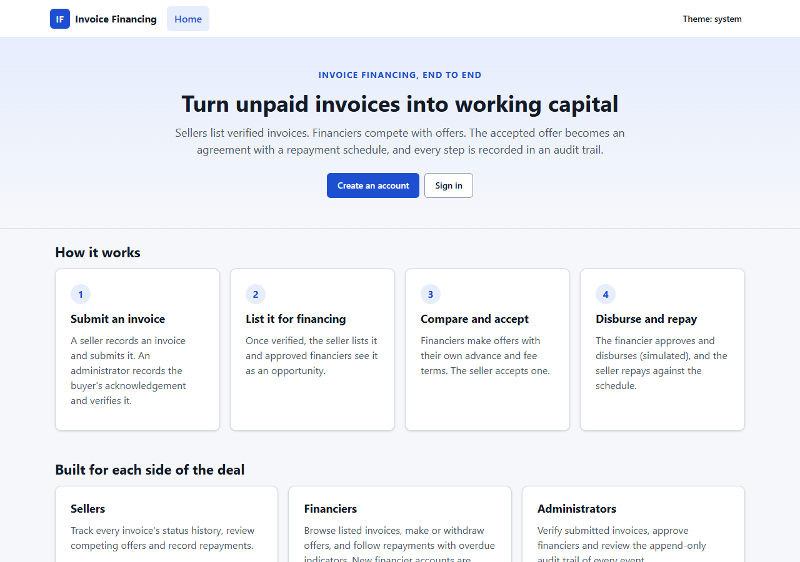
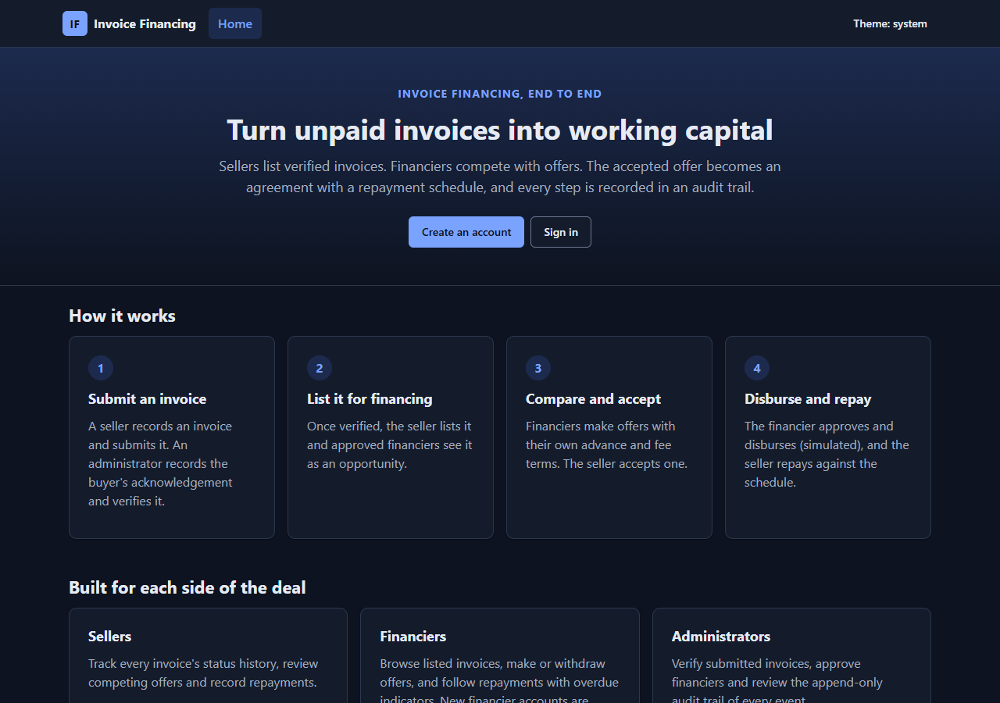

# Invoice Financing Platform

[](https://github.com/harshit-soni-2004/invoice-financing-platform/actions/workflows/ci.yml)

An event-driven microservices platform, built with Spring Boot and Angular, where sellers get early payment on their invoices and financiers compete to fund them.

## What problem it solves

A business that sells on credit waits 30 to 90 days for its buyers to pay, while its own costs are due now. Invoice financing lets that seller raise cash against unpaid invoices: a financier advances most of the invoice amount today and is repaid, with a fee, by the due date. This platform models the whole flow. Sellers upload invoices, the platform verifies them (buyer confirmation and document checks), several financiers compete with offers, and the accepted offer becomes an agreement. The platform then handles approval, disbursement, the repayment schedule, overdue tracking with penalty interest, settlement, notifications and a tamper-resistant audit trail.

> This is a portfolio **simulation**. No real banking, payment gateway or money movement is involved: disbursements and repayments are records, not transfers. All amounts are in INR and handled as `BigDecimal` / `DECIMAL(19,2)`.

## Key features

**Seller**
- Registers and signs in through the platform's own OAuth2 server.
- Creates, edits and cancels draft invoices, submits them for verification and lists verified invoices for financing.
- Compares competing offers (advance, rate, fee, installments, expiry), then accepts one or rejects them with a reason. Accepting closes every other open offer.
- Follows the agreement, the simulated disbursement and the repayment schedule (paid, overdue, penalty interest), and records repayments safely: a retry is recognised, not recorded twice.

**Financier**
- Registers and waits for an administrator's approval before signing in.
- Browses invoices open for financing and makes offers within configurable bounds, or withdraws them.
- Approves agreements and disburses the advance exactly once, then tracks repayments and overdue installments.

**Administrator**
- Works a verification queue: records buyer confirmation, verifies invoices or rejects them with a reason.
- Approves financier accounts.
- Searches the read-only audit trail by event type, record, actor and time range.

Every role gets in-app notifications, and notification-service emails the parties (to a local MailHog inbox).

## Architecture

Six Spring Boot services behind a gateway, each with its own MySQL database and database user. They change each other's state only through events on RabbitMQ, never through direct calls or shared tables. Full design, state machines, financial rules and event contracts: [docs/architecture.md](docs/architecture.md).



## Engineering highlights

- **Own OAuth2 / OIDC server.** auth-service is built on Spring Authorization Server. The Angular app is a public client using Authorization Code + PKCE (S256, enforced), access tokens are RS256 JWTs (15 minutes, keys published as a JWK set with RFC 7638 key IDs), and `iss`, `aud`, `exp` and the algorithm are validated by the gateway **and** again by every service.
- **Transactional outbox with idempotent consumers.** Business rows and their events commit in one local transaction. A relay publishes them with `FOR UPDATE SKIP LOCKED` and publisher confirms, and consumers record each event ID in `processed_events` in the same transaction as their effect, so duplicate deliveries do nothing.
- **Delayed retry queues and dead-letter queues.** Failed events move through 10 s, 1 min and 10 min TTL retry tiers without blocking a consumer thread, then land in a per-queue DLQ. Malformed or business-invalid events go straight to the DLQ. Unroutable events are parked, not lost.
- **Idempotent money operations with row locking.** Disbursement and repayment require an `Idempotency-Key`. The agreement (and installment) rows are locked with `SELECT … FOR UPDATE`, the idempotency record commits with the business change, and replays return the original result with `Idempotent-Replayed: true`. Unique constraints are the final guard against paying or financing twice.
- **Optimistic locking with ETag / If-Match.** Invoice responses carry the row version as a strong `ETag`. Edits require `If-Match`, so a stale write gets `412` instead of overwriting someone else's change, backed by JPA `@Version`.
- **Append-only audit trail enforced by the database.** audit-service records every event with its correlation ID. Its runtime database user has only `SELECT` and `INSERT`, and migrations run as a separate user, so the application cannot alter or delete history.
- **Penalty interest.** Overdue installments accrue a simple daily penalty with a cap, charged exactly once per day even when sweeps overlap (primary key per installment and day, plus row locks). Repayments pay penalty, then fee, then principal.
- **Rate limiting.** The gateway uses Redis token buckets per validated user (or hashed client address), with an explicit fail-open or fail-closed choice per route. auth-service throttles logins per address and per address + username pair.

## Tech stack

| Area | Technologies |
|---|---|
| Backend | Java 21, Spring Boot 3.5, Spring Security, Spring Authorization Server, Spring Cloud Gateway 2025.0, Spring Data JPA, Flyway |
| Messaging and data | RabbitMQ 4.1, MySQL 8.4, Redis 7.4, MailHog (SMTP sink) |
| Frontend | Angular 21 (standalone components, signals, zoneless), TypeScript (strict), SCSS |
| Testing | JUnit 5, Mockito, Testcontainers, Karma + Jasmine, Playwright |
| Delivery | Docker (multi-stage, non-root images), Docker Compose, GitHub Actions, Trivy, SPDX SBOMs, Dependabot |

## Testing

Test cases declared in the source on `main` (counted from `@Test` / `@ParameterizedTest`, `it(` and `test(`; parameterized tests run several cases each):

| Suite | Files | Test cases |
|---|---|---|
| Java unit tests (`*Test`, `*Tests`) | 34 | 166 |
| Java integration tests (`*IT`, Testcontainers with real MySQL, RabbitMQ, Redis and MailHog) | 39 | 217 |
| Angular unit tests (Karma + Jasmine) | 40 | 284 |
| Playwright UI tests with a mocked backend, desktop and phone viewports | 8 | 53 |
| Playwright tests against the real services (opt-in) | 3 | 7 |

Two end-to-end programs exercise the running backend:
- **Smoke test** (`scripts/e2e.ps1`): real sign-in through the login form with PKCE, invoice creation through the gateway, and the negative paths (cross-seller access, wrong role, pending financier, missing PKCE, tampered and `alg=none` tokens rejected by the gateway and by the service directly).
- **Full business flow** (`scripts/e2e-full.ps1`): on disposable infrastructure, an invoice goes from submission to verification and listing, and a financing deal goes through offer, acceptance, approval, idempotent disbursement, partial and final repayment and settlement. It then checks the emails, the audit trail and that every dead-letter queue is empty.

The last recorded full-stack run (see [docs/PROGRESS.md](docs/PROGRESS.md)) passed the smoke test 25/25 and the business flow 41/41 with a clean log scan, before the seller offers merge. CI runs the Maven build with Testcontainers, the frontend checks, the mocked Playwright suite and a full-stack Compose job. The live Playwright specs have not yet passed against the container stack.

## Quick start

Docker is the only requirement:

```bash
cp .env.example .env          # then replace every replace-me-* value
docker compose --profile app up -d --build --wait
```

Then open the frontend at http://localhost:4200 (gateway on :8080, auth-service on :9000, MailHog on :8025). Details are in [Run everything](#run-everything).

## Project status and roadmap

| Status | Scope |
|---|---|
| Done | Foundation and infrastructure; invoice-service; auth-service and gateway; financing-service (offers, agreements, disbursement, repayments, settlement, penalty interest); events, notifications and audit; containers and CI |
| Done (frontend) | Sign-in and registration; seller invoices, offers, agreement and repayments; financier workflow; admin console; notifications |
| In progress | Backend gaps (financier rejection, notification read state, delayed retries in the remaining services); frontend follow-ups; live Playwright against the container stack |
| Planned | Observability (metrics, tracing, dashboards) |
| Planned | Double-entry ledger |
| Planned | Risk scoring for invoices and sellers |
| Planned | AI-assisted invoice data extraction |
| Planned | Load testing |
| Planned | Kubernetes deployment |

There is no hosted demo or production deployment; everything runs locally with Docker Compose. Known issues are listed in [docs/PROGRESS.md](docs/PROGRESS.md).

## Screenshots

<!-- TODO: add screenshots of the seller invoice list, offer comparison, financier agreement and admin queue to docs/screenshots/ and link them here. -->

Landing page, light and dark themes (generated by `SCREENSHOTS=1 npm run e2e:ui`):

| Light | Dark |
|---|---|
|  |  |

## Branching model

- `main` is stable and tested.
- `develop` carries ongoing feature work.
- Feature branches (`feat/...`, `fix/...`) merge into `develop` through pull requests.
- `develop` merges into `main` once it is verified.

See [CONTRIBUTING.md](CONTRIBUTING.md) for commit conventions and how to run the tests.

## License

[MIT](LICENSE)

---

# Developer guide

## Prerequisites

| Tool | Version |
|---|---|
| JDK | 21 |
| Docker Desktop | Engine 29+ with Compose v2 |
| Node.js (frontend only) | 22 LTS, project-local: `scripts/use-local-node.ps1` downloads it into the git-ignored `.tools/` (see [Frontend](#frontend)) |

Maven does not need to be installed. Use the bundled wrapper (`mvnw` / `mvnw.cmd`).

## Run everything

Docker is the only requirement. One command builds the six services and the frontend and starts them with the infrastructure:

```bash
cp .env.example .env          # then replace every replace-me-* value
docker compose --profile app up -d --build --wait
```

`--wait` returns once every container reports healthy. The first build downloads all Maven and npm dependencies and takes several minutes; later builds reuse the cached dependency layers.

| Component | Address |
|---|---|
| Frontend | http://localhost:4200 |
| Gateway (`/api/**`) | http://localhost:8080 |
| auth-service (sign-in page, token issuer) | http://localhost:9000 |
| MailHog UI | http://localhost:8025 |

invoice-, financing-, notification- and audit-service are reachable only inside the Compose network, through the gateway.

How it fits together:
- A one-shot `jwt-keygen` container writes a development signing key into the `jwt-keys` volume on first start and keeps it afterwards. auth-service mounts the volume read-only.
- Tokens carry the browser-visible issuer `AUTH_ISSUER_URI` (`http://localhost:9000`). The gateway and the services check that issuer, but fetch the signing keys from `http://auth-service:9000/oauth2/jwks` inside the network. The `*_URI` values in `.env` that point at `localhost` are only used when the services run on the host.
- The frontend image serves the production build with nginx. Its `config.json` is written at container start from `IFP_PUBLIC_API_URL` and `AUTH_ISSUER_URI`.
- Every container runs as a non-root user, and the service containers have read-only root filesystems.

Host ports are set with `AUTH_PORT`, `GATEWAY_PORT` and `FRONTEND_PORT`. The browser talks to these URLs directly, so when you change a port, also change `AUTH_ISSUER_URI`, `IFP_PUBLIC_API_URL`, `AUTH_SPA_*` and `GATEWAY_CORS_ALLOWED_ORIGINS` to match.

Stop with `docker compose --profile app down`. `down -v` also deletes the data and the signing key.

Without `--profile app`, `docker compose up -d` starts only the infrastructure, for running the services from the IDE (below).

### CI

`.github/workflows/ci.yml` runs on every push and pull request:
- `./mvnw verify` with Testcontainers;
- frontend lint, unit tests and production build;
- the mocked Playwright suite;
- the whole stack in Compose. That last job runs `scripts/e2e/E2eSmokeTest.java` and the live Playwright specs against the containers, then tears the stack down.

`.github/workflows/images.yml` builds every image on `main`, fails on fixable critical Trivy findings, uploads an SPDX SBOM per image and pushes to `ghcr.io/<owner>/ifp/<service>`, tagged `latest` and `sha-<commit>`. The only accepted findings are listed in `.trivyignore`, each with a reason and an expiry date. Dependabot keeps Maven, npm, Docker base images and GitHub Actions current.

To run the published images instead of building, set `IFP_IMAGE_REGISTRY=ghcr.io/<owner>/ifp` and `IFP_IMAGE_TAG=latest` (or a `sha-<commit>` tag) in `.env`, then `docker compose --profile app pull` and `docker compose --profile app up -d --no-build --wait`. The `harshit-soni-2004` packages are public. In a fork, new GHCR packages start private: make them public in the package settings, or run `docker login ghcr.io` first.

The images are multi-arch (`linux/amd64` and `linux/arm64`); both architectures are scanned before the push.

### Free public deployment

There are two zero-cost ways to put the published images online. Both generate their own random secrets and a new admin password, expose only the app, the API gateway and the sign-in server, and keep MySQL, RabbitMQ, Redis and MailHog private:

- **Demo from this PC** (Windows, Docker Desktop): run `powershell -ExecutionPolicy Bypass -File deploy/tunnel/start-demo.ps1`. It starts the stack as Compose project `ifp-demo` on ports 34200, 38080 and 39000, opens three Cloudflare quick tunnels (no account needed), and prints three `https://*.trycloudflare.com` URLs. The URLs change on every start, and the demo is online only while the PC is on. The admin password is `ADMIN_BOOTSTRAP_PASSWORD` in `.env.demo`. `deploy/tunnel/stop-demo.ps1` stops it; add `-RemoveData` to delete the data and `.env.demo` too.
- **Always-on server**: an Oracle Cloud Always Free Arm VM with HTTPS from Let's Encrypt. See [deploy/oracle/README.md](deploy/oracle/README.md).

## Local infrastructure

```bash
cp .env.example .env          # then replace every replace-me-* value
docker compose up -d --wait   # MySQL, RabbitMQ, Redis, MailHog
docker compose ps             # all four should be "healthy"
```

| Component | Host address |
|---|---|
| MySQL | `127.0.0.1:3307` (3307 avoids clashing with a local MySQL install) |
| RabbitMQ AMQP / UI | `127.0.0.1:5672` / http://localhost:15672 |
| Redis | `127.0.0.1:6379` |
| MailHog SMTP / UI | `127.0.0.1:1025` / http://localhost:8025 |

All ports bind to `127.0.0.1` only. On first start, MySQL creates one database and one least-privilege user per service. To verify isolation:

```bash
docker exec -i ifp-mysql bash < scripts/verify-mysql-privileges.sh
```

Stop with `docker compose down`. Data survives in named volumes. `docker compose down -v` **deletes all local data**.

## Build and test

```bash
./mvnw verify        # Windows: .\mvnw.cmd verify
```

Unit tests (`*Test`, `*Tests`) run in the `test` phase, and integration tests (`*IT`, Testcontainers) run in `verify`. Integration tests need Docker running. They start their own disposable MySQL, Redis, RabbitMQ and MailHog containers and never touch the Compose data. One module only: `.\mvnw.cmd verify -pl services/gateway -am`.

### End-to-end check

`scripts/e2e.ps1` starts the infrastructure, generates the development key if needed, builds and starts auth-service, invoice-service and the gateway, then runs `scripts/e2e/E2eSmokeTest.java` against them:

```powershell
.\scripts\e2e.ps1                       # default ports 9000 / 8081 / 8080
.\scripts\e2e.ps1 -GatewayPort 18080    # if 8080 is taken; -SkipBuild reuses existing jars
```

It registers two sellers and a financier with a random password, signs in through the real login form (CSRF token included) with Authorization Code + PKCE, creates and reads an invoice through the gateway, and checks that:
- another seller gets 404;
- a seller gets 403 on admin operations;
- a pending financier cannot sign in;
- PKCE is enforced;
- missing, garbage, tampered and `alg=none` tokens are rejected by the gateway **and** by invoice-service directly.

Service logs are written to `target/e2e/` and scanned for tokens, private keys and the configured passwords; the run fails if anything is found. Logs are deleted after a clean run. Only the processes the script started are stopped.

### Full backend flow on disposable infrastructure

`scripts/e2e-full.ps1` needs no `.env`. It starts its own MySQL, RabbitMQ, Redis and MailHog from `infra/e2e/compose.e2e.yml` under a unique project name, with random passwords, ephemeral ports and data in tmpfs. It then starts all five services and the gateway on free ports, with a throwaway signing key and bootstrap admin, and runs `scripts/e2e/E2eFullFlowTest.java`:

```powershell
.\scripts\e2e-full.ps1              # -SkipBuild reuses existing jars; -KeepInfrastructure leaves the containers up
```

The test registers a seller and a financier and has the admin activate the financier. It then walks an invoice through submission, buyer confirmation, verification and listing, and a financing deal through offer, acceptance, approval, simulated disbursement (including an idempotent replay), a partial and a final repayment, and settlement. It checks that:
- the listed invoice reaches financing-service, and disbursement and settlement move the invoice to `FINANCED` and `SETTLED`;
- each party receives exactly the expected emails in MailHog, none of them containing amounts;
- the audit trail holds every invoice, offer and agreement event, with the request's correlation ID and without email addresses, and is closed to non-admins;
- every dead-letter queue and the unrouted queue are empty at the end.

The development stack and its volumes are never touched, and the disposable containers are removed afterwards.

## Frontend

Angular 21 (LTS) in `frontend/`: standalone components, signals, zoneless change detection, strict TypeScript and plain SCSS with light and dark themes. The phase plan named Angular 19, but 19 is end-of-life and its last release has unpatched high-severity advisories, so the app uses the 21 LTS line instead.

Node is project-local. Dot-sourcing the helper downloads Node 22.23.4 into the git-ignored `.tools/node`, verifies it against the official SHA-256 list, and puts it first on `PATH` for the current PowerShell session only. The system Node installation and npm configuration are not touched.

```powershell
. .\scripts\use-local-node.ps1
cd frontend
npm ci                 # install exactly what package-lock.json pins
npm start              # dev server on http://localhost:4200
npm run lint
npm run test:ci        # Karma + Jasmine in headless Chrome
npm run build          # production build in dist/frontend
npm run e2e:ui         # Playwright UI checks at desktop and phone sizes (uses the installed Chrome)
```

`public/config.json` holds the gateway URL (`apiBaseUrl`), the auth-service issuer (`authIssuer`) and the OAuth2 client ID. It is read at startup rather than compiled in, so the same build can point at any environment. `$env:SCREENSHOTS = '1'; npm run e2e:ui` refreshes the images in `docs/screenshots/`.

**Sign-in.** "Sign in", or any page that needs an account (`/account`, `/seller`, `/financier`, `/admin`), sends the browser to auth-service's login page with Authorization Code + PKCE (see [Login flow](#4-login-flow)). The access token stays in memory, so reloading the page goes back through auth-service. Its session cookie skips the password, so the user only sees a brief redirect. The session ends with the 15-minute access token, after which the app asks the user to sign in again. "Sign out" also ends the auth-service session.

**Seller invoices.** `/seller` lists the signed-in seller's invoices from `GET /api/invoices`, newest first, 20 per page, with a status filter. The browser never names a seller: invoice-service scopes every request to the seller in the access token, and another seller's invoice is a 404. "New invoice" (`/seller/invoices/new`) creates a draft with `POST /api/invoices`. The form checks the same formats as invoice-service: invoice number characters, GSTIN, an amount with at most 2 decimals, and a due date after the issue date. Configurable limits (maximum amount, tenor, days to maturity) are left to invoice-service, whose message is shown next to the field. `/seller/invoices/{id}` shows the details and offers the two seller transitions, each enabled only in the status that allows it: "Submit for verification" for a draft and "Make available to financiers" for a verified invoice. Both send the invoice's `ETag` as `If-Match`. If the invoice changed in the meantime, invoice-service refuses with `412` or `409`, and the page explains why and shows the stored state. The page only shows a new status after invoice-service confirms it. "Edit details" (drafts only) replaces the draft with `PUT /api/invoices/{id}`, and "Cancel invoice" (draft, submitted or verified, after a confirmation with an optional reason) uses `POST /api/invoices/{id}/cancel`; both send `If-Match`, and a stale edit shows the stored invoice instead of overwriting it.

**Seller financing.** While an invoice is `FINANCING_AVAILABLE`, its page lists the offers from `GET /api/financing/offers?invoiceId=` (advance, rate, fee, installments, expiry, status). Open, unexpired offers can be accepted, after a confirmation that says every other open offer closes, or rejected with an optional reason. Accepting shows the new agreement awaiting the financier's approval; the invoice itself becomes `FINANCED` only when invoice-service hears of the payout. Once an agreement exists, the page shows it with the simulated disbursement, the repayment schedule (paid, overdue, penalty interest) and the repayment history. "Record repayment" posts to `POST /api/financing/agreements/{id}/repayments` with an `Idempotency-Key` that stays the same while the seller retries the same amount, so a retry after a lost response is reported as already recorded rather than recorded twice. The app finds an invoice's agreement among the seller's 1,000 most recent agreements, because financing-service has no lookup by invoice.

**Financier workflow.** `/financier` lists invoices open for offers from `GET /api/financing/opportunities`, 20 per page, sortable by due date, amount or invoice number (financing-service offers no filters). `/financier/opportunities/{invoiceId}` shows the invoice, the financier's own offers on it (`GET /api/financing/offers?invoiceId=…`), and an offer form (`POST /api/financing/offers`) that checks financing-service's default bounds before sending: advance up to the invoice's cap, a rate above 0% and at most 36% a year, a fee below the advance, 1 to 12 installments that fit before the due date, and an expiry within 14 days and before the due date starts (India time). financing-service's own answer is authoritative and is shown next to the field it concerns. An open offer can be withdrawn. `/financier/agreements` lists the financier's agreements with a status filter. `/financier/agreements/{id}` offers "Approve agreement" only while the agreement awaits approval and "Disburse advance" (after a confirmation) only once it is approved, then shows the simulated disbursement and the repayment schedule with paid and overdue installments. Once any penalty interest is reported, the summary adds penalty accrued and outstanding (repaid and outstanding totals include penalty, as financing-service computes them), and the schedule adds a penalty column with the unpaid part and the date it is accrued to. A note states that the penalty rate and cap come from financing-service configuration and that their defaults are placeholders awaiting business sign-off. Disbursement sends an `Idempotency-Key` that stays the same when the user retries after a lost answer, so a retry is answered from the first result instead of paying twice. financing-service sends no `ETag`s, so no `If-Match` is needed. A state that changed meanwhile (`409`), a refused action (`403`), rate limiting (`429`), outages and network failures each get their own message, and the latest state is shown. Rejecting or cancelling an agreement is not in the app yet.

**Admin console.** `/admin` is for administrators only. The invoice queue (`/admin/invoices`) lists `SUBMITTED` invoices (awaiting buyer confirmation) and `BUYER_CONFIRMED` invoices (awaiting verification) from `GET /api/invoices?status=`. Each invoice's review page loads it with its `ETag` and offers only the steps invoice-service allows from its status: buyer confirmation for submitted invoices, verification for buyer-confirmed ones, and rejection with a required reason (up to 500 characters) for both. Every step sends `If-Match`; `412` and `409` show the stored state instead of the requested one. Financier approvals (`/admin/financiers`) lists `GET /api/admin/users?role=FINANCIER&status=PENDING_APPROVAL` and approves with `POST /api/admin/users/{id}/activate`. "Reject" asks for confirmation, takes an optional reason (up to 500 characters, recorded in the audit log) and calls `POST /api/admin/users/{id}/reject`. Rejection is final: the account can never sign in. A row shows "Rejected" only after auth-service confirms it; an application another admin decided first (`409`) shows its stored status, and a refusal (`403`) is explained. The audit log (`/admin/audit`) is a read-only, paginated view of `GET /api/audit-events` with the filters audit-service supports: event type, record type and ID, actor and a time range.

**Notifications.** `/notifications` lists the signed-in user's notifications from `GET /api/notifications` for every role, with whether each was emailed and whether it is read. Each unread notification can be marked as read (`POST /api/notifications/{id}/read`), or all at once (`POST /api/notifications/read-all`). The unread count in the header comes from `GET /api/notifications/unread-count`, so it is the same in every browser; it is refreshed after marking, when the page loads, and at most every 30 seconds on navigation. If the count cannot be fetched, the header shows nothing rather than a guess.

**Registration.** `/register` creates a seller or financier account through the gateway's `POST /api/auth/register`. Administrators are never offered. The form checks the same rules as auth-service before sending: a password of 12+ characters, at most 72 UTF-8 bytes, and not the email address. Duplicate emails, server validation errors, rate limiting (`429`, using `Retry-After` when present), network failures and outages each get their own message. Registration does not sign the user in. A seller is pointed to "Sign in", and a financier is told that the account waits for an administrator's approval and that sign-in is refused until then.

`npm run e2e:ui` stands in for auth-service and the gateway inside the browser, so it needs no backend. To check sign-in, registration and the seller's invoices against the real services, start auth-service, invoice-service (with the `dev` profile) and the gateway as described in [Running the services locally](#running-the-services-locally), then run the opt-in checks. They register new sellers and financiers with random passwords, and the invoice check only creates invoices for its own new seller. The app must be served on `localhost`, because auth-service only accepts the registered `http://localhost:4200/auth/callback`:

```powershell
npx ng serve --host localhost              # in a separate terminal
$env:IFP_STACK = '1'; $env:UI_BASE_URL = 'http://localhost:4200'
# $env:IFP_GATEWAY_URL = 'http://localhost:18080'   # only if the gateway is not on :8080
# $env:IFP_AUTH_URL = 'http://localhost:19000'      # only if auth-service is not on :9000 (must match authIssuer in config.json)
npx playwright test e2e/auth.live.spec.ts
npx playwright test e2e/register.live.spec.ts
npx playwright test e2e/seller-invoices.live.spec.ts
```

The gateway allows 5 registrations per burst per client address, refilling one every 12 seconds. The three files together make 8 registration requests, so run them separately, about a minute apart. The registration and invoice checks run at desktop size only for this reason.

npm 10 (bundled with Node 22) installs reliably from the lockfile, but crashes with `Cannot read properties of null (reading 'edgesOut')` when it resolves this dependency tree from scratch. To add or upgrade a dependency, run `npx -y npm@11 install <package>`, then check the result with `npm ci`.

## Running the services locally

### 1. Signing key (development only)

```powershell
.\scripts\generate-dev-jwt-key.ps1     # macOS/Linux: ./scripts/generate-dev-jwt-key.sh
```

This writes an RSA-3072 PKCS#8 key to `infra/keys/jwt-signing-key.pem` (git-ignored, readable only by you). It never overwrites an existing key. Never commit it and never use it outside your machine; production keys belong in a secret store. auth-service refuses to start without a key unless the `dev` profile is active, which falls back to an in-memory key that changes on every restart (all tokens become invalid).

### 2. Start the services and the gateway

Build once, then start each service in its own terminal from the repository root. Define `Get-DotEnv` in each terminal; it reads a value from `.env` without printing it. Every service except the gateway also needs the RabbitMQ credentials.

```powershell
.\mvnw.cmd -B package -DskipTests
function Get-DotEnv($name) { (Get-Content .env | Select-String "^$name=").Line.Split('=', 2)[1] }
# In each service terminal (not needed for the gateway):
$env:RABBITMQ_USER = Get-DotEnv RABBITMQ_USER; $env:RABBITMQ_PASSWORD = Get-DotEnv RABBITMQ_PASSWORD

# Terminal 1: auth-service on :9000 (Redis holds the login rate-limit counters)
$env:DB_PASSWORD = Get-DotEnv AUTH_DB_PASSWORD
$env:REDIS_PASSWORD = Get-DotEnv REDIS_PASSWORD
$env:AUTH_JWT_PRIVATE_KEY_LOCATION = 'file:./infra/keys/jwt-signing-key.pem'
java -jar services/auth-service/target/auth-service-0.1.0-SNAPSHOT.jar

# Terminal 2: invoice-service on :8081 (dev profile adds DEMO- seed invoices)
$env:DB_PASSWORD = Get-DotEnv INVOICE_DB_PASSWORD
$env:SPRING_PROFILES_ACTIVE = 'dev'
java -jar services/invoice-service/target/invoice-service-0.1.0-SNAPSHOT.jar

# Terminal 3: financing-service on :8082
$env:DB_PASSWORD = Get-DotEnv FINANCING_DB_PASSWORD
java -jar services/financing-service/target/financing-service-0.1.0-SNAPSHOT.jar

# Terminal 4: notification-service on :8083 (mail goes to MailHog, http://localhost:8025)
$env:DB_PASSWORD = Get-DotEnv NOTIFICATION_DB_PASSWORD
java -jar services/notification-service/target/notification-service-0.1.0-SNAPSHOT.jar

# Terminal 5: audit-service on :8084 (Flyway uses the migrator user, the app the append-only user)
$env:DB_PASSWORD = Get-DotEnv AUDIT_DB_PASSWORD
$env:DB_MIGRATOR_PASSWORD = Get-DotEnv AUDIT_DB_MIGRATOR_PASSWORD
java -jar services/audit-service/target/audit-service-0.1.0-SNAPSHOT.jar

# Terminal 6: gateway on :8080
$env:REDIS_PASSWORD = Get-DotEnv REDIS_PASSWORD
java -jar services/gateway/target/gateway-0.1.0-SNAPSHOT.jar
```

The dev seed invoices predate the event pipeline and are never published, so they do not appear in financing opportunities. Invoices you create and list through the API do. Inspect queues, including each `<queue>.dlq` and financing's delayed retry tiers (`financing.invoice-events.retry.*`), at http://localhost:15672. See `docs/architecture.md` for the replay procedure.

| Variable | Default | Used by | Purpose |
|---|---|---|---|
| `AUTH_ISSUER_URI` | `http://localhost:9000` | all | Issuer that tokens carry and services require |
| `AUTH_JWK_SET_URI` | `http://localhost:9000/oauth2/jwks` | gateway, invoice, financing, notification, audit | Where signing keys are fetched |
| `AUTH_AUDIENCE` | `ifp-api` | all | Required `aud` value |
| `AUTH_JWT_PRIVATE_KEY_LOCATION` | (none) | auth | PKCS#8 PEM signing key |
| `AUTH_SPA_REDIRECT_URIS` / `AUTH_SPA_ALLOWED_ORIGINS` | `http://localhost:4200/...` | auth | Registered SPA callback and origins |
| `ADMIN_BOOTSTRAP_EMAIL` / `ADMIN_BOOTSTRAP_PASSWORD` | (none) | auth | Optional first ADMIN, created only if none exists |
| `DB_HOST` / `DB_PORT` / `DB_PASSWORD` | `localhost` / `3307` / (none) | all except gateway | Each service's own database user |
| `DB_MIGRATOR_USERNAME` / `DB_MIGRATOR_PASSWORD` | `audit_migrator` / (none) | audit | Schema owner used only by Flyway |
| `RABBITMQ_HOST` / `RABBITMQ_PORT` / `RABBITMQ_USER` / `RABBITMQ_PASSWORD` | `localhost` / `5672` / (none) / (none) | all except gateway | Event broker |
| `MAIL_HOST` / `MAIL_PORT` / `NOTIFICATION_FROM` | `localhost` / `1025` / `no-reply@ifp.local` | notification | Local SMTP sink (MailHog) and sender address |
| `AUTH_SERVICE_URI` / `INVOICE_SERVICE_URI` / `FINANCING_SERVICE_URI` / `NOTIFICATION_SERVICE_URI` / `AUDIT_SERVICE_URI` | `http://localhost:9000` / `:8081` / `:8082` / `:8083` / `:8084` | gateway | Route targets |
| `FINANCING_MAX_ADVANCE_RATIO` / `FINANCING_MAX_ANNUAL_RATE` / `FINANCING_MAX_OFFER_VALIDITY` / `FINANCING_MIN_DAYS_TO_MATURITY` / `FINANCING_MAX_INSTALLMENTS` | `0.98` / `0.3600` / `14d` / `7` / `12` | financing | Bounds on offer terms (financiers always set the actual terms) |
| `FINANCING_REPAYMENT_REMINDER_DAYS` / `FINANCING_REPAYMENT_REMINDER_SWEEP_INTERVAL` | `3` / `15m` | financing | "Due soon" window and how often reminders are checked |
| `REDIS_HOST` / `REDIS_PORT` / `REDIS_PASSWORD` | `localhost` / `6379` / (none) | gateway, auth | Rate-limit store |
| `AUTH_RATE_LIMIT_IP_REQUESTS` / `AUTH_RATE_LIMIT_IP_WINDOW` | `30` / `1m` | auth | Requests per client address to `POST /login` and to `POST /oauth2/token` |
| `AUTH_RATE_LIMIT_MAX_FAILURES` / `AUTH_RATE_LIMIT_FAILURE_WINDOW` / `AUTH_RATE_LIMIT_LOCKOUT` | `5` / `15m` / `5m` | auth | Failed logins per client address + username before a lockout, and its length |
| `IFP_MESSAGING_PURGE_RETENTION` / `IFP_MESSAGING_PURGE_INTERVAL` | `7d` / `1h` | auth, invoice, financing | How long published outbox rows are kept, and how often they are purged |
| `GATEWAY_CORS_ALLOWED_ORIGINS` | `http://localhost:4200` | gateway | Explicit origins (`*` is rejected at startup) |
| `GATEWAY_TRUSTED_PROXY_HOPS` | `0` | gateway | Trusted `X-Forwarded-For` hops |
| `RATE_LIMIT_PUBLIC_*` / `RATE_LIMIT_API_*` | see `.env.example` | gateway | Token-bucket sizes and failure modes |

### 3. Development users

There are no built-in users or default passwords.

- **SELLER / FINANCIER:** register through the gateway. Financiers start `PENDING_APPROVAL` and cannot sign in until an admin activates them.

  ```powershell
  $body = @{ email = 'seller@example.test'; password = '<choose 12+ characters>'; displayName = 'Demo Seller'; role = 'SELLER' } | ConvertTo-Json
  Invoke-RestMethod -Method Post -Uri http://localhost:8080/api/auth/register -ContentType 'application/json' -Body $body
  ```
- **ADMIN:** cannot self-register. Set `ADMIN_BOOTSTRAP_EMAIL` and `ADMIN_BOOTSTRAP_PASSWORD` (your own values, never committed) before starting auth-service once; it creates the admin only if none exists. The admin activates financiers with `POST /api/admin/users/{id}/activate`.

### 4. Login flow

The SPA (Phase 6) is the public OAuth2 client `ifp-spa`. It sends the browser to `http://localhost:9000/oauth2/authorize` with an S256 PKCE challenge. The user signs in on auth-service's own login page, and the SPA exchanges the returned code plus its PKCE verifier at `/oauth2/token`. Requests without PKCE are refused, and no refresh tokens are issued to the public client. The resulting access token (15 minutes) is sent as `Authorization: Bearer ...` to `http://localhost:8080/api/**`. Discovery is at `http://localhost:9000/.well-known/openid-configuration`, and keys are at `/oauth2/jwks`. These stay on auth-service (the issuer) and are not routed through the gateway.

`GET /actuator/health`, `/actuator/health/liveness` and `/actuator/health/readiness` are public on every service. Readiness also requires the service's database. RabbitMQ and Redis are deliberately not part of it, because the outbox and the rate-limit failure modes already handle their outages. Everything else on the gateway requires a valid token, except `POST /api/auth/register`.

The `dev` profile seed is demo data only: fictional sellers and buyers, with invoice numbers prefixed `DEMO-`. Production migrations live in `db/migration`, and the seed lives in `db/seed-dev`.

## Logging

Logs go to stdout as one JSON object per line (Elastic Common Schema), with `service.name` and the `correlationId` of the request or consumed event. For human-readable lines while developing, add the `local` profile (`SPRING_PROFILES_ACTIVE=local`, or `dev,local` for invoice-service), which prints the correlation ID in brackets. Every request carries an `X-Correlation-Id`, which appears in logs and response headers. A malformed incoming ID is replaced with a fresh UUID rather than forwarded. Log statements contain IDs, statuses, event types and exception class names only, never emails, tokens, passwords or amounts.

## Troubleshooting

- **`ports are not available ... 3306`**: another MySQL is running. Change `MYSQL_PORT` in `.env`.
- **MySQL init script fails with `/bin/bash^M`**: the script has Windows line endings. `.gitattributes` forces LF. If it happened anyway, convert the file, then `docker compose down`, `docker volume rm invoice-financing_mysql-data` (deletes local MySQL data) and start again. Init scripts only run on an empty volume.
- **auth-service: "No JWT signing key configured"**: generate the key (step 1) and set `AUTH_JWT_PRIVATE_KEY_LOCATION`, or use `SPRING_PROFILES_ACTIVE=dev` for a throwaway in-memory key.
- **401 for every token**: issuer mismatch. `AUTH_ISSUER_URI` must be identical (scheme, host, port) for auth-service, the gateway and invoice-service. Tokens issued before an auth-service restart with an ephemeral key are no longer valid.
- **invoice-service: "Detected applied migration not resolved locally: dev demo invoices"**: the local database was migrated with the `dev` profile. Start it with `SPRING_PROFILES_ACTIVE=dev` again.
- **429 on registration**: the public route allows 5 requests per client address per burst (one more every 12 s). Authenticated APIs are limited per user.
- **e2e.ps1: "Port 8080 is already in use"**: another application holds the port. Pass `-GatewayPort` (or `-AuthPort` / `-InvoicePort`).
- **Login page redirects back with `?error`**: wrong password, or a financier still pending approval.
- **429 on `/login` or `/oauth2/token`**: five failed logins for the same username from the same address lock that pair out for 5 minutes, and each address may make 30 requests per minute to each endpoint. `Retry-After` says how long to wait.
