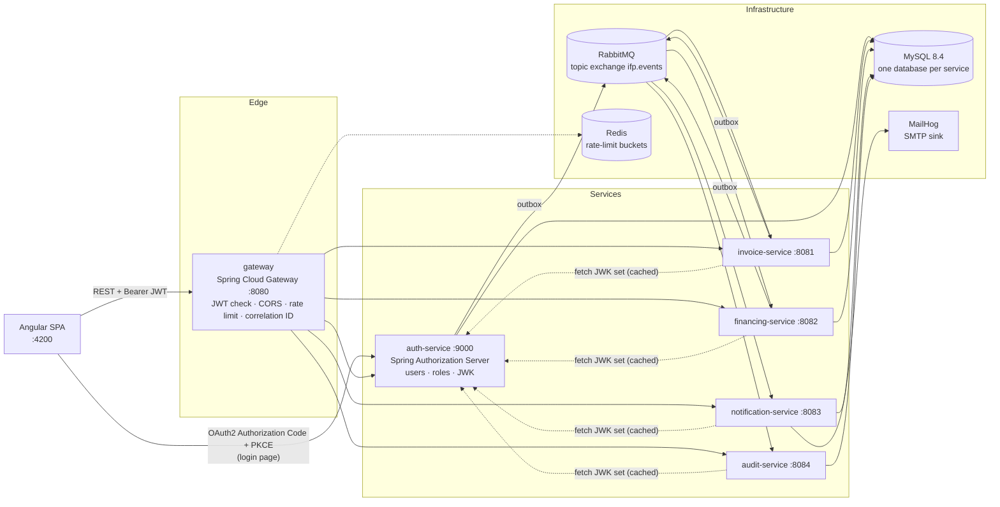
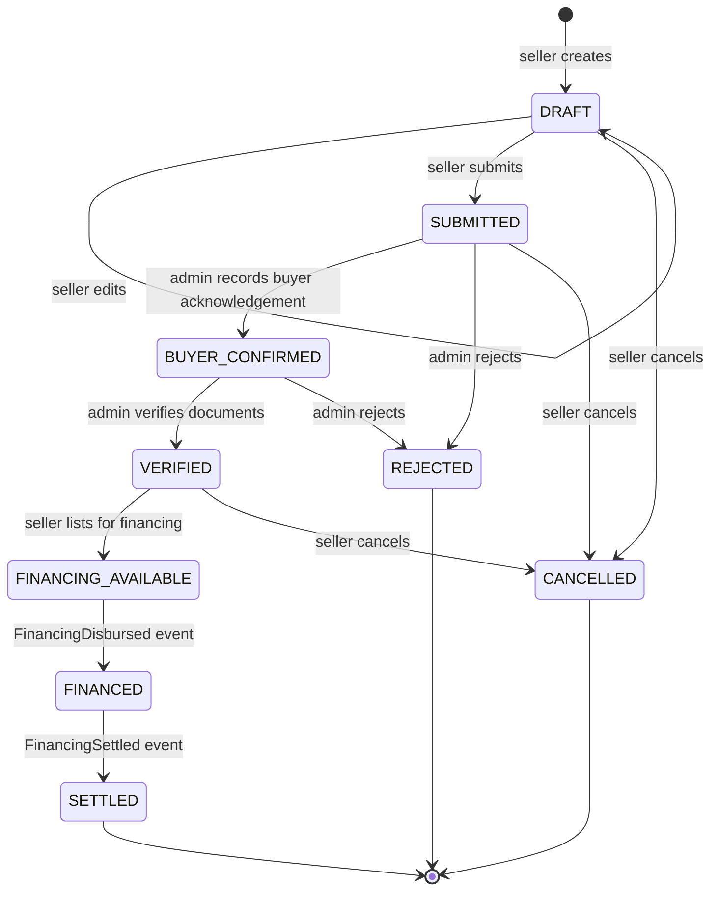
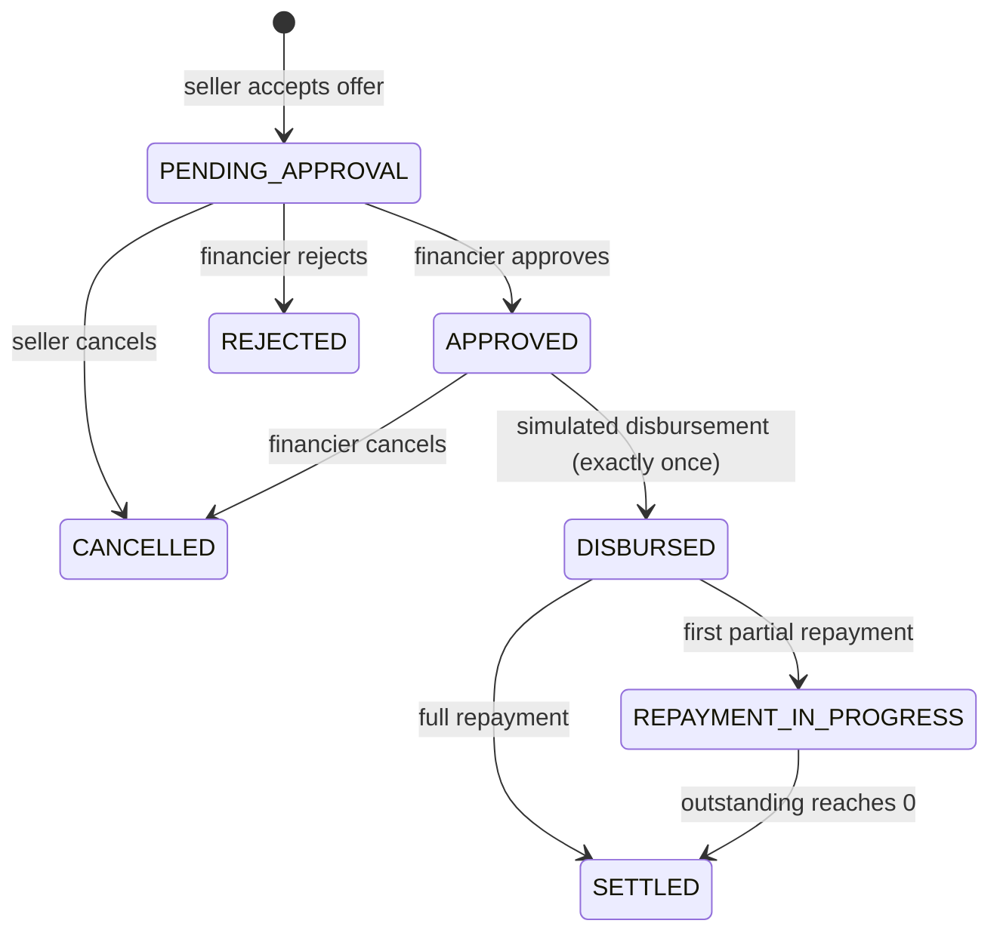
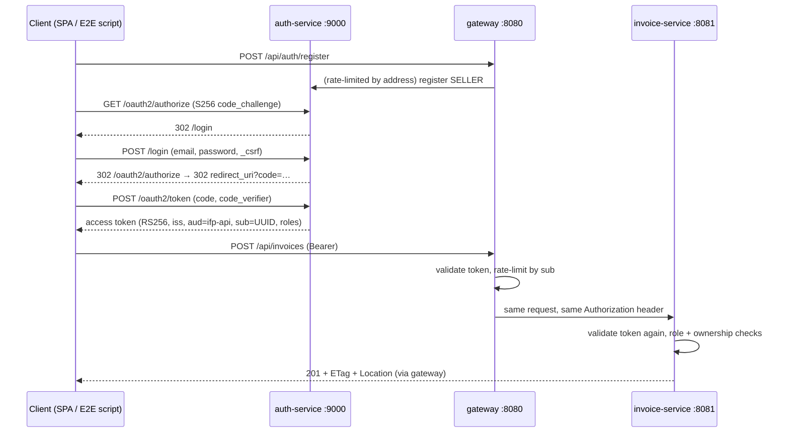

# Architecture

> Portfolio simulation of invoice financing. **No real money moves.** Disbursements and repayments are records, not bank transfers.

## 1. System context



### Communication rules

| Interaction | Style | Why |
|---|---|---|
| Browser → services | Synchronous REST through the gateway | The user is waiting for an answer |
| Service → service state changes | Asynchronous events over RabbitMQ | Services stay available when another service is down |
| Service → auth-service | JWK set fetch only (cached) | Needed to verify JWT signatures locally |

Services never call each other's REST APIs to change state, and never read another service's database.
financing-service keeps a **local read model** of financeable invoices built from invoice events (event-carried state transfer). That means it does not need to call invoice-service while a financier is making an offer.

## 2. Repository layout

```
invoice-financing-platoform/
├── pom.xml                      Maven parent (Boot 3.5.16, Spring Cloud 2025.0.3, Java 21)
├── mvnw, mvnw.cmd, .mvn/        Maven wrapper (pins Maven 3.9.9)
├── platform-common/             Thin cross-cutting library: correlation IDs (later: event envelope)
├── services/
│   ├── auth-service/            :9000
│   ├── invoice-service/         :8081
│   ├── financing-service/       :8082
│   ├── notification-service/    :8083
│   ├── audit-service/           :8084
│   └── gateway/                 :8080
├── frontend/                    Angular 19 app (Phase 6)
├── infra/mysql/init/            First-boot script: databases + least-privilege users
├── scripts/                     Dev utilities (privilege check, RSA key generation)
├── docs/                        Architecture, event contracts, decisions
├── docker-compose.yml
└── .env.example                 Placeholders only. The real .env is git-ignored
```

`platform-common` holds technical conventions only. Business rules live inside the service that owns them, so a shared library change can never silently alter another service's domain behaviour.

## 3. Data ownership

Each service has its own MySQL database and its own database user. The init script grants a user privileges on its own database only (checked by `scripts/verify-mysql-privileges.sh`). References across services are plain IDs (UUIDs) with **no cross-database foreign keys**.

| Database | Owner | Core tables |
|---|---|---|
| `auth_db` | auth-service | **Implemented (Phase 3):** `users` (email unique, case-insensitive; BCrypt hash; role; status; version) and Spring Authorization Server's `oauth2_authorization` (authorization codes and issued tokens, so codes stay single-use across restarts). The only client, `ifp-spa`, is registered in code and needs no consent screen, so there are no `oauth2_registered_client` or consent tables. **Phase 5:** `outbox_events` |
| `invoice_db` | invoice-service | **Implemented (Phase 2):** `invoices` (unique `seller_id + invoice_number`, case-insensitive; `amount DECIMAL(19,2)`; CHECK constraints for positive amount, `currency = 'INR'`, `due_date > issue_date` and valid status; `version`) and `invoice_status_history` (FK to `invoices`). **Phase 5:** `outbox_events`, `processed_events` |
| `financing_db` | financing-service | `financeable_invoices` (read model), `financing_offers`, `financing_agreements` (unique `offer_id`; generated `active_invoice_id` unique so only one live agreement per invoice), `disbursements` (unique `agreement_id`), `repayment_installments`, `repayments` (unique idempotency key), `outbox_events`, `processed_events` |
| `notification_db` | notification-service | `recipients` (read model from `UserRegistered`), `notifications` (unique `event_id + recipient`), `processed_events` |
| `audit_db` | audit-service | `audit_events` (unique `event_id`, JSON metadata). Runtime user has **SELECT/INSERT only**, so the trail is append-only at the database level |

Common conventions:

- UUID primary keys are stored as `BINARY(16)`.
- Timestamps are `DATETIME(6)` holding UTC values. The MySQL server runs with `default-time-zone=+00:00` and Hibernate uses `jdbc.time_zone=UTC`. `DATETIME` is used instead of `TIMESTAMP` to avoid session time-zone conversion and the 2038 limit.
- The application `Clock` ticks in whole microseconds. MySQL rounds sub-microsecond digits rather than truncating them, so finer timestamps would make the stored value differ from the one returned to the client.
- Calendar-date rules ("today") use the configurable business zone `Asia/Kolkata`.
- Money is `DECIMAL(19,2)` mapped to `BigDecimal`.
- Mutable aggregates have a `version` column for optimistic locking.
- Flyway owns every schema, and Hibernate runs with `ddl-auto=validate`.
- Development seed data lives in a separate Flyway location (`db/seed-dev`) that only the `dev` profile enables.

## 4. State machines

Invoice status and financing status are separate. invoice-service only learns about financing through events.

### Invoice (invoice-service)



Buyer confirmation and document verification are two explicit steps. Uploading an invoice does not prove the debt exists. In this simulation an ADMIN acts as the verification desk.

### Offer (financing-service)

`OFFERED → ACCEPTED | REJECTED (seller) | WITHDRAWN (financier) | EXPIRED (expiry passed) | CLOSED (another offer on the same invoice was accepted)`

### Financing agreement (financing-service)



"Overdue" is not a state. It is derived from installments whose due date has passed with an unpaid balance.

### Financial rules

- `advance ≤ invoice amount × financing.max-advance-ratio` (configurable, default 0.98).
- Discount fee = `advance × annual rate × days(disbursement → due date) / 365` + flat processing fee, rounded `HALF_EVEN` to 2 decimals. Total repayable = advance + fees.
  Example: ₹4,80,000 advance at 12% p.a. for 60 days gives a fee of ₹9,468.49 and ₹4,89,468.49 repayable.
- An expired offer cannot be accepted (the check happens at accept time, plus a scheduled expiry sweep).
- Disbursement is guarded three ways: the agreement must be `APPROVED`, the `disbursements.agreement_id` unique constraint, and an `Idempotency-Key` header. A replayed request returns the original result.
- A repayment must be `0 < amount ≤ outstanding`, and is rejected once the agreement is `SETTLED`. Optimistic locking on the agreement serializes concurrent repayments.

## 5. First API endpoints (via gateway `http://localhost:8080`)

| Method & path | Role | Purpose |
|---|---|---|
| `POST /api/auth/register` | public | Register a SELLER or FINANCIER (FINANCIER accounts start `PENDING_APPROVAL`; ADMIN cannot be self-registered) |
| `GET /api/users/me` | any | Current profile |
| `GET /api/admin/users` · `POST /api/admin/users/{id}/activate` | ADMIN | User management |
| `POST /api/invoices` · `PUT /api/invoices/{id}` | SELLER | Create, or edit a DRAFT |
| `GET /api/invoices?status=&page=&size=` · `GET /api/invoices/{id}` | SELLER (own) / ADMIN | List & detail |
| `POST /api/invoices/{id}/submit` · `/cancel` · `/list-for-financing` | SELLER (own) | Lifecycle |
| `POST /api/invoices/{id}/buyer-confirmation` · `/verify` · `/reject` | ADMIN | Verification desk |
| `GET /api/invoices/{id}/history` | owner / ADMIN | Status timeline |
| `GET /api/financing/opportunities` | FINANCIER | Invoices open for offers |
| `POST /api/financing/offers` · `POST /api/financing/offers/{id}/withdraw` | FINANCIER | Create / withdraw offer |
| `GET /api/financing/offers` · `GET /api/financing/offers/{id}` | SELLER / FINANCIER (scoped) | Offers |
| `POST /api/financing/offers/{id}/accept` · `/reject` | SELLER (invoice owner) | Decide on offer |
| `POST /api/financing/agreements/{id}/approve` · `/reject` · `/disburse` | FINANCIER (owner) | Approval & simulated disbursement (`Idempotency-Key` required) |
| `GET /api/financing/agreements/{id}/schedule` · `/repayments` | parties | Schedule & history |
| `POST /api/financing/agreements/{id}/repayments` | SELLER (owner) | Record simulated repayment (`Idempotency-Key` required) |
| `GET /api/notifications` · `POST /api/notifications/{id}/read` | any (own) | Notifications |
| `GET /api/audit-events?entityId=&eventType=&from=&to=` | ADMIN | Read-only audit queries |

The auth and user endpoints (Phase 3) and the invoice endpoints (Phase 2) are **implemented** and routed by the gateway. Other rows are planned.

Errors use RFC 9457 `application/problem+json` with a machine-readable `code`:

| Status | Meaning |
|---|---|
| 400 | Malformed or invalid input; `errors[]` lists the failing fields |
| 401 | Missing or invalid token |
| 403 | Wrong role |
| 404 | Not found, or owned by someone else (existence is not revealed) |
| 409 | Invalid status transition, duplicate invoice number, not editable, or concurrent modification |
| 412 | `If-Match` does not match the current version |
| 422 | Business rule violated, for example `DUE_DATE_TOO_SOON` |
| 428 | `If-Match` missing on `PUT` |

Lists are paginated (`size` at most 100) and sorted only by whitelisted fields. Ownership always comes from the JWT `sub`, never from a request field. A seller-supplied `sellerId` filter is ignored.

**Concurrency contract.** Responses carry a strong `ETag` equal to the row version (for example `"3"`). `PUT` requires `If-Match`. Status-change endpoints accept an optional `If-Match`, and concurrent writers are also caught by `@Version` optimistic locking. Each status change flushes the versioned `UPDATE` before inserting its history row. The invoice row's exclusive lock is therefore taken first, and a concurrent writer fails on the version check instead of deadlocking on the history foreign key.

## 6. Event contracts

Topic exchange `ifp.events`, routing key `<aggregate>.<event>` (for example `invoice.submitted`). Envelope (schema version 1):

```json
{
  "eventId": "6f1c…",            "eventType": "InvoiceSubmitted",
  "schemaVersion": 1,             "occurredAt": "2026-10-27T10:15:30.123Z",
  "producer": "invoice-service",  "aggregateType": "INVOICE",
  "aggregateId": "b2e4…",         "actorId": "user UUID or null",
  "correlationId": "…",           "payload": { }
}
```

| Event | Producer | Consumers |
|---|---|---|
| `UserRegistered` | auth | notification (recipient directory), audit |
| `InvoiceSubmitted`, `InvoiceBuyerConfirmed`, `InvoiceVerified`, `InvoiceRejected`, `InvoiceCancelled` | invoice | notification, audit |
| `InvoiceListedForFinancing` | invoice | financing (read model), notification, audit |
| `FinancingOfferCreated`, `FinancingOfferAccepted`, `FinancingOfferRejected` | financing | notification, audit |
| `FinancingApproved`, `RepaymentRecorded` | financing | notification, audit |
| `FinancingDisbursed`, `FinancingSettled` | financing | invoice (status), notification, audit |

Events carry IDs, amounts, dates and statuses. They never carry passwords, tokens or email addresses (notification-service resolves recipients from its own read model).

Reliability (Phase 5):

- **Outbox:** the business row and its outbox row are written in one local transaction. A poller publishes rows with publisher confirms and marks them sent only after the broker acks. Delivery is at-least-once.
- **Idempotent consumers:** `processed_events(event_id PK)` is inserted in the same transaction as the business effect. A duplicate delivery hits the primary key and is skipped.
- **Retry/DLQ:** bounded retries with exponential backoff, then reject-without-requeue to `<queue>.dlq` through the dead-letter exchange `ifp.events.dlx`. The documented replay procedure is shovel-based.
- Exactly-once delivery across services is **not** claimed.

## 7. Security decisions

| Topic | Decision |
|---|---|
| Login | Angular is a **public OAuth2 client** using Authorization Code + PKCE against auth-service. The login form is served by auth-service, so the SPA never handles passwords. |
| Tokens | RS256 JWT access tokens, 15 min (configurable), with `iss` and `aud=ifp-api` validated by the gateway **and** by every service (defense in depth). The SPA keeps tokens **in memory**, not localStorage. |
| Token contract | `sub` = user UUID (tokens with any other subject are rejected with 401). `roles` = array of `SELLER`/`FINANCIER`/`ADMIN`, mapped to `ROLE_*` authorities; unknown roles grant nothing. `aud` must contain `ifp-api`. Only RS256 is accepted. auth-service must issue exactly this shape in Phase 3. |
| Implementation status | **Phase 3:** auth-service issues exactly this token shape and re-reads role and status from the database at issuance; the gateway validates it at the edge; invoice-service still validates signature, issuer, audience, expiry and algorithm itself and applies `@PreAuthorize` role checks plus service-layer ownership checks. The gateway is not the only security boundary: calling invoice-service directly with an invalid token is rejected too (checked by the end-to-end script). |
| Issuer in Docker | Issuer is fixed to the browser-visible URL (`http://localhost:9000`). Services fetch keys from the internal `jwk-set-uri` (`http://auth-service:9000/oauth2/jwks`) and validate the issuer string explicitly. |
| Keys | `scripts/generate-dev-jwt-key.ps1` / `.sh` writes an RSA-3072 PKCS#8 key into the git-ignored `infra/keys/`. Private keys are never committed. auth-service refuses to start without a key file; an in-memory ephemeral key is allowed only when the `dev` profile (or a test) sets `auth.jwt.allow-ephemeral-key=true`. The `kid` is the RFC 7638 thumbprint, and retired public keys can stay published during rotation. |
| CSRF | Disabled for stateless bearer-token APIs (no auth cookies). Enabled on the auth-service login form, which is session-based. |
| CORS | Explicit origins, methods and headers from configuration (default origin `http://localhost:4200`), applied at the gateway on `/api/**`. Credentials are not allowed (tokens travel in a header, not cookies), and a `*` origin fails startup validation. auth-service has its own CORS list for the browser's `/oauth2/token` call. |
| Passwords | `DelegatingPasswordEncoder` (BCrypt by default). |
| Authorization | Role checks plus ownership checks in the service layer. Hiding UI buttons is never relied on. |
| Rate limiting | Gateway `RequestRateLimiter` with Redis token buckets, keyed by validated JWT subject (or a hashed client address when unauthenticated), with an explicit per-route failure mode. See [Gateway](#gateway). |
| Logging | Correlation ID in MDC. Authorization headers, tokens, passwords, amounts and account numbers are never logged. |

### Gateway

The gateway (Spring Cloud Gateway, reactive) holds no business logic. Each request passes through, in order:

1. **Correlation ID** (`CorrelationIdWebFilter`, first filter). A valid `X-Correlation-Id` (8–64 chars of `[A-Za-z0-9._-]`) is kept; anything else is **replaced** with a fresh UUID, never forwarded. The ID is set on the forwarded request and on every response, including 401/403/429.
2. **Spring Security** (`SecurityConfig`), stateless: no session, no request cache, and CSRF, form login and basic auth disabled.

   | Path | Rule |
   |---|---|
   | `/actuator/health/**`, `/actuator/info` | public |
   | `POST /api/auth/register` | public |
   | `/api/admin/**` | `ROLE_ADMIN` |
   | `/api/**` | any valid token |
   | anything else | denied |

   Tokens are decoded by a `NimbusReactiveJwtDecoder`:
   - RS256 only, with keys from `AUTH_JWK_SET_URI`.
   - The issuer, audience, required `exp` and UUID `sub` are all validated.
   - An unknown `kid` triggers a JWK set refetch, so a newly published key is accepted without a restart (key rotation).

   401 and 403 responses are fixed `application/problem+json` bodies; they never include the token, key IDs or the validation failure reason.
3. **CORS** is checked by Spring Security for `/api/**` with the configured explicit lists. A disallowed origin gets 403 before routing.
4. **Routing and rate limiting.**

   | Route | Target | Limiter |
   |---|---|---|
   | `POST /api/auth/register` | auth-service | `publicRateLimiter` |
   | `/api/users/**`, `/api/admin/users/**` | auth-service | `apiRateLimiter` |
   | `/api/invoices/**` | invoice-service | `apiRateLimiter` |

   The original `Authorization` header is forwarded unchanged. The gateway adds **no** identity headers (`X-User-Id` etc.). Downstream services authenticate the token themselves and never trust headers set by the edge.
5. **Errors** (`GatewayErrorHandler`). Downstream error responses pass through unchanged. Failures to reach a service map to fixed problem bodies without hosts, ports or exception text:
   - connection refused or unknown host: 503 `DOWNSTREAM_UNAVAILABLE`
   - response timeout (default 10 s): 504 `DOWNSTREAM_TIMEOUT`
   - no route: 404
   - anything else: 500

The OAuth2/OIDC endpoints (`/oauth2/*`, `/login`, `/.well-known/*`, `/oauth2/jwks`) are served by auth-service at the issuer URL and are **not** routed through the gateway. The issuer must be one stable browser-visible URL, and the login page's session cookie and CSRF token belong to that origin.

#### Rate-limiting policy

Spring Cloud Gateway's token-bucket Lua script runs atomically in Redis. Each route's limits come from configuration (`RATE_LIMIT_*` environment variables):

| Limiter | Key | Default | If Redis is unavailable |
|---|---|---|---|
| `publicRateLimiter` (registration) | `ip:<first 128 bits of SHA-256(client address)>` | bursts of 5, then 5/min | **FAIL_CLOSED**: 429 |
| `apiRateLimiter` (authenticated APIs) | `user:<validated token sub>` | bursts of 40, then 20/s | **FAIL_OPEN**: request continues with `X-RateLimit-Unavailable: true` |

- **Keys never contain raw tokens or raw IP addresses.** The user key is the validated subject, so a user cannot escape their bucket by fetching new tokens. The client address is the TCP peer. `X-Forwarded-For` is honoured only for `GATEWAY_TRUSTED_PROXY_HOPS` trusted proxies (default 0), so clients cannot choose their own bucket. Hashing addresses is pseudonymisation, not anonymisation; keys expire with the bucket.
- **Why different failure modes.** The stock `RedisRateLimiter` silently allows all traffic when Redis fails. Here the choice is explicit per route:
  - Registration is unauthenticated and abuse-prone, so a Redis outage must not remove its only throttle.
  - Authenticated API calls have already passed full token validation, and the services still enforce roles and ownership. Failing open there means a Redis outage removes throttling but **never authentication or authorization**. It does not take down the authenticated product.
  - Unauthenticated requests to protected APIs are rejected by security before any limiter runs.
- A Redis call is bounded by `gateway.rate-limit.redis-timeout` (default 750 ms), after which the failure mode applies. The gateway's health check does not include Redis, so an outage does not fail liveness probes.
- Exceeding a limit returns 429. Allowed responses carry `X-RateLimit-Remaining`.

#### End-to-end flow (verified by `scripts/e2e.ps1`)



The script also checks the negative paths:
- another seller gets 404 for the invoice;
- a seller gets 403 on admin operations (from invoice-service) and on admin user APIs (at the gateway);
- a pending financier cannot sign in;
- requests without PKCE, or with the wrong verifier, are refused;
- missing, garbage, tampered and `alg=none` tokens get 401 from both the gateway and invoice-service directly.

## 8. Trade-offs

- **Microservices vs modular monolith:** six deployables add operational cost (more containers, eventual consistency, distributed debugging). They are used here to demonstrate service boundaries and reliable messaging. A real early-stage product would likely start as a modular monolith.
- **Eventual consistency:** invoice status updates to `FINANCED` a moment after disbursement. The UI shows the financing-service view as the source of truth for money.
- **Shared MySQL server:** separate databases and users enforce ownership, but one server is a shared failure domain. That is acceptable locally, and production would separate them.
- **In-listener retries** block a consumer thread during backoff. That is simple and bounded, though delayed retry queues would scale better.
- **Correlation IDs are replaced, not rejected.** A malformed `X-Correlation-Id` gets a fresh UUID instead of a 400. Tracing is best-effort metadata, the malformed value is never forwarded or logged, and this matches the behaviour every service already has through `platform-common`.
- **The login form is not behind the gateway**, so gateway rate limits do not cover password guessing on `/login`. Mitigations today are BCrypt cost and the 12-character minimum. Login throttling or lockout in auth-service (or at a reverse proxy in front of it) is a follow-up.
- **Unknown-`kid` refetch.** A token with an unseen key ID makes the gateway and services refetch the JWK set. That is what makes rotation seamless, but a flood of forged tokens could amplify load on `/oauth2/jwks`. Nimbus caches the set, and production would put the JWK endpoint behind a cache or CDN.
- **Fail-open API rate limiting** trades abuse protection for availability during a Redis outage. Authentication and authorization still apply, and registration fails closed.
- **MailHog** has been unmaintained since 2020. It is used because it was specified, and Mailpit is a drop-in alternative.
- **Flyway 11.7.2**, the version Spring Boot 3.5.16 manages, logs "upgrade recommended" for MySQL 8.4 because it was not tested against that version. Migrations are verified against MySQL 8.4 by the integration tests. The Spring Boot-managed version is kept rather than overridden.
- **Mockito agent JVM notice:** tests load Mockito with `-javaagent`, which is the setup Mockito documents now that runtime self-attach is deprecated (JEP 451). This removes the self-attach warnings. Each test JVM still prints "Sharing is only supported for boot loader classes because bootstrap classpath has been appended". That notice comes from class-data sharing (CDS) and is harmless. It is not hidden with `-Xshare:off`, which would only slow test startup.

## 9. Roadmap

| Phase | Scope | Depends on |
|---|---|---|
| 1 Foundation ✅ | Repo config, Compose infra (MySQL, RabbitMQ, Redis, MailHog), DB isolation, service skeletons, correlation IDs | — |
| 2 Invoices ✅ | invoice-service domain, Flyway, state machine, REST, ETag/If-Match, dev-only seed data, **JWT validation and role/ownership authorization for invoice-service**, unit + Testcontainers ITs | 1 |
| 3 Auth & gateway ✅ | auth-service (Authorization Server, users, registration, RSA key management, token contract above), gateway routes/token validation/CORS/rate limit/correlation IDs, negative authz tests, repeatable end-to-end script. Resource-server config for financing/notification/audit lands with those services (Phases 4–5) | 1, 2 |
| 4 Financing | Read model, offers, agreements, disbursement idempotency, schedules, repayments, settlement, concurrency tests | 3 |
| 5 Events | Outbox in auth/invoice/financing, consumers, notification & audit services, retries/DLQ, duplicate-delivery tests | 2–4 |
| 6 Frontend | Angular 19 seller/financier/admin workflows against real APIs | 3–5 |
| 7 Containers & CI | Dockerfiles (multi-stage, non-root), full Compose, health ordering, GitHub Actions | 1–6 |
| 8 Verification | End-to-end run, security pass, final docs | all |
