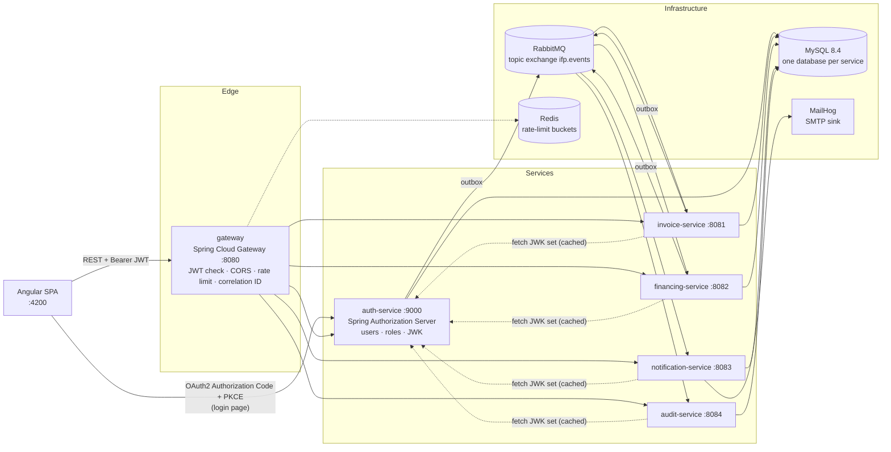
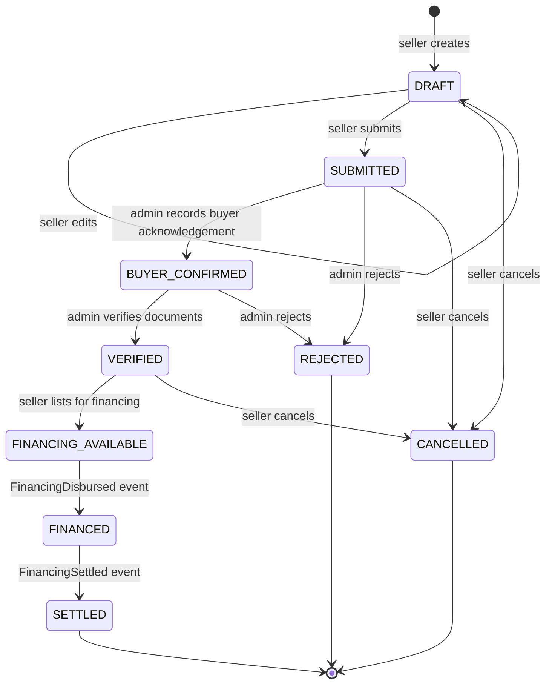
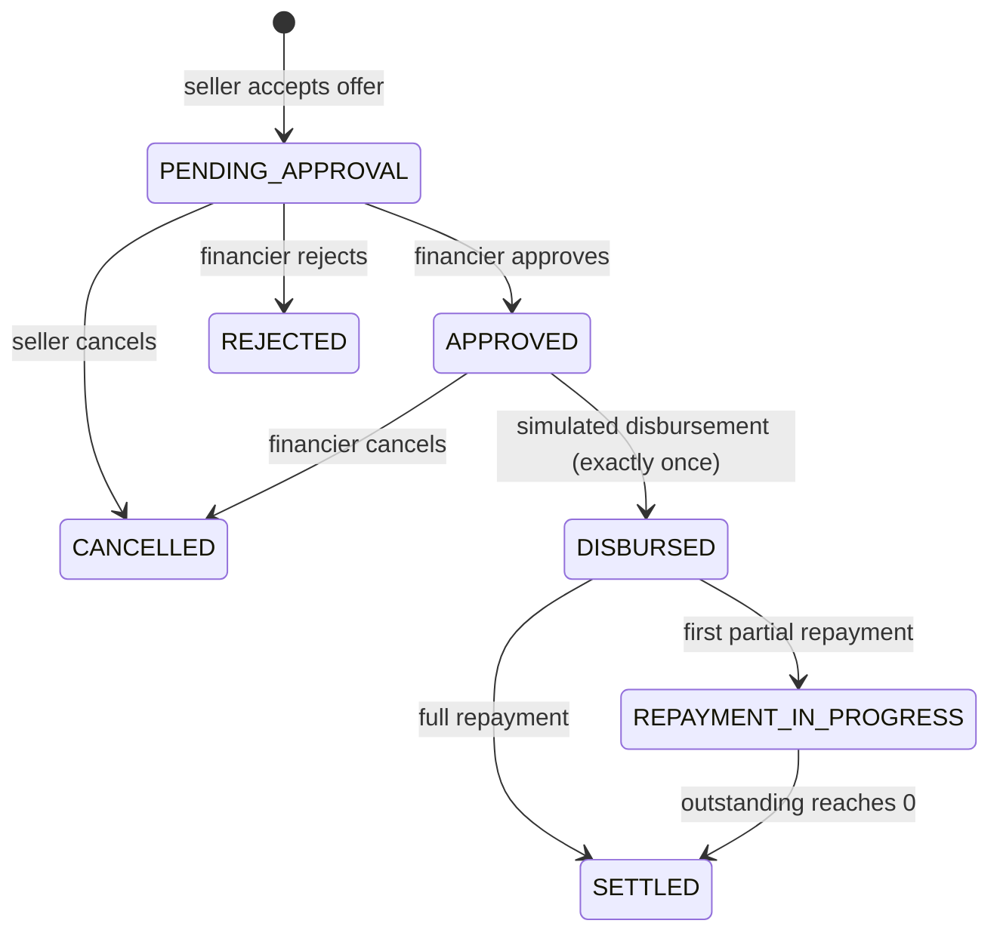

# Architecture

> Portfolio simulation of invoice financing. **No real money moves.** Disbursements and repayments are records, not bank transfers.

## 1. System context



### Communication rules

| Interaction | Style | Why |
|---|---|---|
| Browser → services | Synchronous REST through the gateway | The user is waiting for an answer |
| Service → service state changes | Asynchronous events over RabbitMQ | Services stay available when another service is down |
| Service → auth-service | JWK set fetch only (cached) | Needed to verify JWT signatures locally |

Services never call each other's REST APIs to change state, and never read another service's database.
financing-service keeps a **local read model** of financeable invoices built from invoice events (event-carried state transfer). That means it does not need to call invoice-service while a financier is making an offer.

## 2. Repository layout

```
invoice-financing-platoform/
├── pom.xml                      Maven parent (Boot 3.5.16, Spring Cloud 2025.0.3, Java 21)
├── mvnw, mvnw.cmd, .mvn/        Maven wrapper (pins Maven 3.9.9)
├── platform-common/             Thin cross-cutting library: correlation IDs (later: event envelope)
├── services/
│   ├── auth-service/            :9000
│   ├── invoice-service/         :8081
│   ├── financing-service/       :8082
│   ├── notification-service/    :8083
│   ├── audit-service/           :8084
│   └── gateway/                 :8080
├── frontend/                    Angular 19 app (Phase 6)
├── infra/mysql/init/            First-boot script: databases + least-privilege users
├── scripts/                     Dev utilities (privilege check, RSA key generation)
├── docs/                        Architecture, event contracts, decisions
├── docker-compose.yml
└── .env.example                 Placeholders only. The real .env is git-ignored
```

`platform-common` holds technical conventions only. Business rules live inside the service that owns them, so a shared library change can never silently alter another service's domain behaviour.

## 3. Data ownership

Each service has its own MySQL database and its own database user. The init script grants a user privileges on its own database only (checked by `scripts/verify-mysql-privileges.sh`). References across services are plain IDs (UUIDs) with **no cross-database foreign keys**.

| Database | Owner | Core tables |
|---|---|---|
| `auth_db` | auth-service | `users` (email unique, BCrypt hash, role, status, version), Spring Authorization Server tables (`oauth2_registered_client`, `oauth2_authorization`, `oauth2_authorization_consent`), `outbox_events` |
| `invoice_db` | invoice-service | `invoices` (unique `seller_id + invoice_number`, `amount DECIMAL(19,2)`, `currency CHAR(3)`, status, `version`), `invoice_status_history`, `outbox_events`, `processed_events` |
| `financing_db` | financing-service | `financeable_invoices` (read model), `financing_offers`, `financing_agreements` (unique `offer_id`; generated `active_invoice_id` unique so only one live agreement per invoice), `disbursements` (unique `agreement_id`), `repayment_installments`, `repayments` (unique idempotency key), `outbox_events`, `processed_events` |
| `notification_db` | notification-service | `recipients` (read model from `UserRegistered`), `notifications` (unique `event_id + recipient`), `processed_events` |
| `audit_db` | audit-service | `audit_events` (unique `event_id`, JSON metadata). Runtime user has **SELECT/INSERT only**, so the trail is append-only at the database level |

Common conventions: UUID primary keys stored as `BINARY(16)`. `created_at`/`updated_at` are `TIMESTAMP(6)` in UTC (the MySQL server runs with `default-time-zone=+00:00`). Money is `DECIMAL(19,2)` mapped to `BigDecimal`. Mutable aggregates have a `version` column for optimistic locking. Flyway owns every schema, and Hibernate runs with `ddl-auto=validate`.

## 4. State machines

Invoice status and financing status are separate. invoice-service only learns about financing through events.

### Invoice (invoice-service)



Buyer confirmation and document verification are two explicit steps. Uploading an invoice does not prove the debt exists. In this simulation an ADMIN acts as the verification desk.

### Offer (financing-service)

`OFFERED → ACCEPTED | REJECTED (seller) | WITHDRAWN (financier) | EXPIRED (expiry passed) | CLOSED (another offer on the same invoice was accepted)`

### Financing agreement (financing-service)



"Overdue" is not a state. It is derived from installments whose due date has passed with an unpaid balance.

### Financial rules

- `advance ≤ invoice amount × financing.max-advance-ratio` (configurable, default 0.98).
- Discount fee = `advance × annual rate × days(disbursement → due date) / 365` + flat processing fee, rounded `HALF_EVEN` to 2 decimals. Total repayable = advance + fees.
  Example: ₹4,80,000 advance at 12% p.a. for 60 days gives a fee of ₹9,468.49 and ₹4,89,468.49 repayable.
- An expired offer cannot be accepted (the check happens at accept time, plus a scheduled expiry sweep).
- Disbursement is guarded three ways: the agreement must be `APPROVED`, the `disbursements.agreement_id` unique constraint, and an `Idempotency-Key` header. A replayed request returns the original result.
- A repayment must be `0 < amount ≤ outstanding`, and is rejected once the agreement is `SETTLED`. Optimistic locking on the agreement serializes concurrent repayments.

## 5. First API endpoints (via gateway `http://localhost:8080`)

| Method & path | Role | Purpose |
|---|---|---|
| `POST /api/auth/register` | public | Register a SELLER or FINANCIER (FINANCIER accounts start `PENDING_APPROVAL`; ADMIN cannot be self-registered) |
| `GET /api/users/me` | any | Current profile |
| `GET /api/admin/users` · `POST /api/admin/users/{id}/activate` | ADMIN | User management |
| `POST /api/invoices` · `PUT /api/invoices/{id}` | SELLER | Create, or edit a DRAFT |
| `GET /api/invoices?status=&page=&size=` · `GET /api/invoices/{id}` | SELLER (own) / ADMIN | List & detail |
| `POST /api/invoices/{id}/submit` · `/cancel` · `/list-for-financing` | SELLER (own) | Lifecycle |
| `POST /api/invoices/{id}/buyer-confirmation` · `/verify` · `/reject` | ADMIN | Verification desk |
| `GET /api/invoices/{id}/history` | owner / ADMIN | Status timeline |
| `GET /api/financing/opportunities` | FINANCIER | Invoices open for offers |
| `POST /api/financing/offers` · `POST /api/financing/offers/{id}/withdraw` | FINANCIER | Create / withdraw offer |
| `GET /api/financing/offers` · `GET /api/financing/offers/{id}` | SELLER / FINANCIER (scoped) | Offers |
| `POST /api/financing/offers/{id}/accept` · `/reject` | SELLER (invoice owner) | Decide on offer |
| `POST /api/financing/agreements/{id}/approve` · `/reject` · `/disburse` | FINANCIER (owner) | Approval & simulated disbursement (`Idempotency-Key` required) |
| `GET /api/financing/agreements/{id}/schedule` · `/repayments` | parties | Schedule & history |
| `POST /api/financing/agreements/{id}/repayments` | SELLER (owner) | Record simulated repayment (`Idempotency-Key` required) |
| `GET /api/notifications` · `POST /api/notifications/{id}/read` | any (own) | Notifications |
| `GET /api/audit-events?entityId=&eventType=&from=&to=` | ADMIN | Read-only audit queries |

Errors use RFC 9457 `application/problem+json`. Lists are paginated. Ownership always comes from the JWT `sub`, never from a request field.

## 6. Event contracts

Topic exchange `ifp.events`, routing key `<aggregate>.<event>` (for example `invoice.submitted`). Envelope (schema version 1):

```json
{
  "eventId": "6f1c…",            "eventType": "InvoiceSubmitted",
  "schemaVersion": 1,             "occurredAt": "2026-10-27T10:15:30.123Z",
  "producer": "invoice-service",  "aggregateType": "INVOICE",
  "aggregateId": "b2e4…",         "actorId": "user UUID or null",
  "correlationId": "…",           "payload": { }
}
```

| Event | Producer | Consumers |
|---|---|---|
| `UserRegistered` | auth | notification (recipient directory), audit |
| `InvoiceSubmitted`, `InvoiceBuyerConfirmed`, `InvoiceVerified`, `InvoiceRejected`, `InvoiceCancelled` | invoice | notification, audit |
| `InvoiceListedForFinancing` | invoice | financing (read model), notification, audit |
| `FinancingOfferCreated`, `FinancingOfferAccepted`, `FinancingOfferRejected` | financing | notification, audit |
| `FinancingApproved`, `RepaymentRecorded` | financing | notification, audit |
| `FinancingDisbursed`, `FinancingSettled` | financing | invoice (status), notification, audit |

Events carry IDs, amounts, dates and statuses. They never carry passwords, tokens or email addresses (notification-service resolves recipients from its own read model).

Reliability (Phase 5):

- **Outbox:** the business row and its outbox row are written in one local transaction. A poller publishes rows with publisher confirms and marks them sent only after the broker acks. Delivery is at-least-once.
- **Idempotent consumers:** `processed_events(event_id PK)` is inserted in the same transaction as the business effect. A duplicate delivery hits the primary key and is skipped.
- **Retry/DLQ:** bounded retries with exponential backoff, then reject-without-requeue to `<queue>.dlq` through the dead-letter exchange `ifp.events.dlx`. The documented replay procedure is shovel-based.
- Exactly-once delivery across services is **not** claimed.

## 7. Security decisions

| Topic | Decision |
|---|---|
| Login | Angular is a **public OAuth2 client** using Authorization Code + PKCE against auth-service. The login form is served by auth-service, so the SPA never handles passwords. |
| Tokens | RS256 JWT access tokens, 15 min (configurable), with `iss` and `aud=ifp-api` validated by the gateway **and** by every service (defense in depth). The SPA keeps tokens **in memory**, not localStorage. |
| Issuer in Docker | Issuer is fixed to the browser-visible URL (`http://localhost:9000`). Services fetch keys from the internal `jwk-set-uri` (`http://auth-service:9000/oauth2/jwks`) and validate the issuer string explicitly. |
| Keys | Dev RSA keys are generated by a script into a git-ignored folder. Private keys are never committed. |
| CSRF | Disabled for stateless bearer-token APIs (no auth cookies). Enabled on the auth-service login form, which is session-based. |
| CORS | Allowed origins come from configuration (default `http://localhost:4200`), applied at the gateway. |
| Passwords | `DelegatingPasswordEncoder` (BCrypt by default). |
| Authorization | Role checks plus ownership checks in the service layer. Hiding UI buttons is never relied on. |
| Rate limiting | Gateway `RequestRateLimiter` backed by Redis, keyed by JWT subject (or client IP when unauthenticated). |
| Logging | Correlation ID in MDC. Authorization headers, tokens, passwords, amounts and account numbers are never logged. |

## 8. Trade-offs

- **Microservices vs modular monolith:** six deployables add operational cost (more containers, eventual consistency, distributed debugging). They are used here to demonstrate service boundaries and reliable messaging. A real early-stage product would likely start as a modular monolith.
- **Eventual consistency:** invoice status updates to `FINANCED` a moment after disbursement. The UI shows the financing-service view as the source of truth for money.
- **Shared MySQL server:** separate databases and users enforce ownership, but one server is a shared failure domain. That is acceptable locally, and production would separate them.
- **In-listener retries** block a consumer thread during backoff. That is simple and bounded, though delayed retry queues would scale better.
- **MailHog** has been unmaintained since 2020. It is used because it was specified, and Mailpit is a drop-in alternative.

## 9. Roadmap

| Phase | Scope | Depends on |
|---|---|---|
| 1 Foundation ✅ | Repo config, Compose infra (MySQL, RabbitMQ, Redis, MailHog), DB isolation, service skeletons, correlation IDs | — |
| 2 Invoices | invoice-service domain, Flyway, state machine, REST, Testcontainers ITs, seed data | 1 |
| 3 Auth & gateway | Authorization Server, users, RSA keys, resource-server config in all services, gateway routes/CORS/rate limit, negative authz tests | 1, 2 |
| 4 Financing | Read model, offers, agreements, disbursement idempotency, schedules, repayments, settlement, concurrency tests | 3 |
| 5 Events | Outbox in auth/invoice/financing, consumers, notification & audit services, retries/DLQ, duplicate-delivery tests | 2–4 |
| 6 Frontend | Angular 19 seller/financier/admin workflows against real APIs | 3–5 |
| 7 Containers & CI | Dockerfiles (multi-stage, non-root), full Compose, health ordering, GitHub Actions | 1–6 |
| 8 Verification | End-to-end run, security pass, final docs | all |
