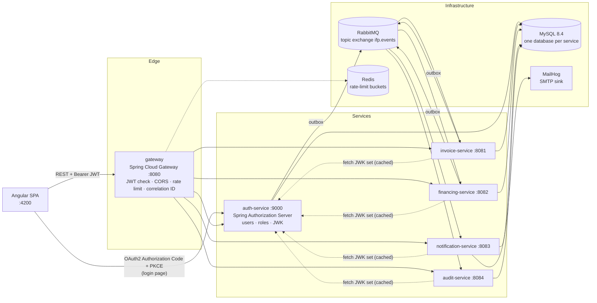
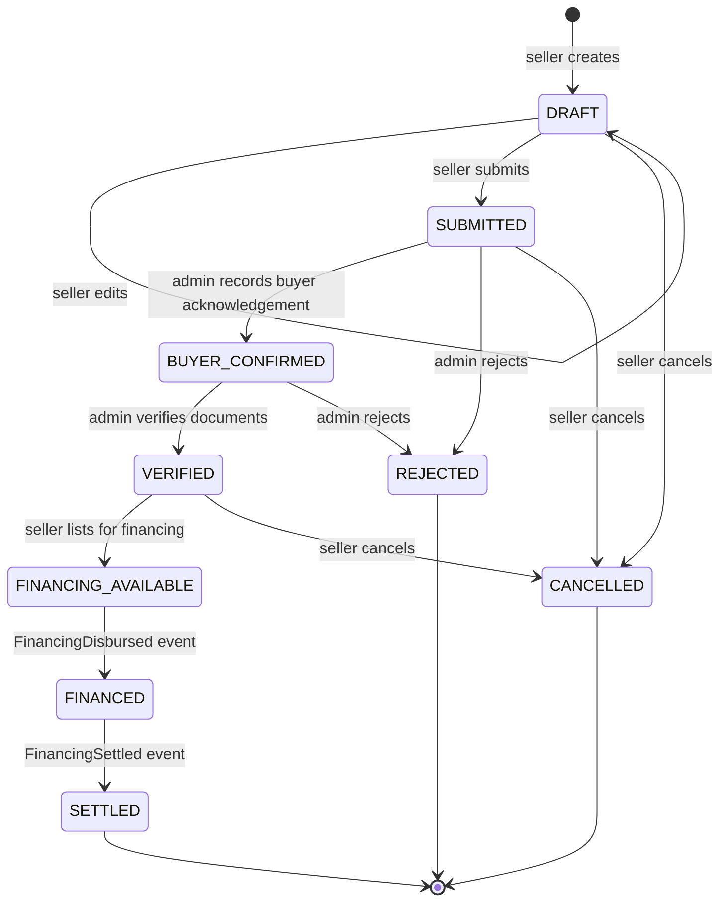
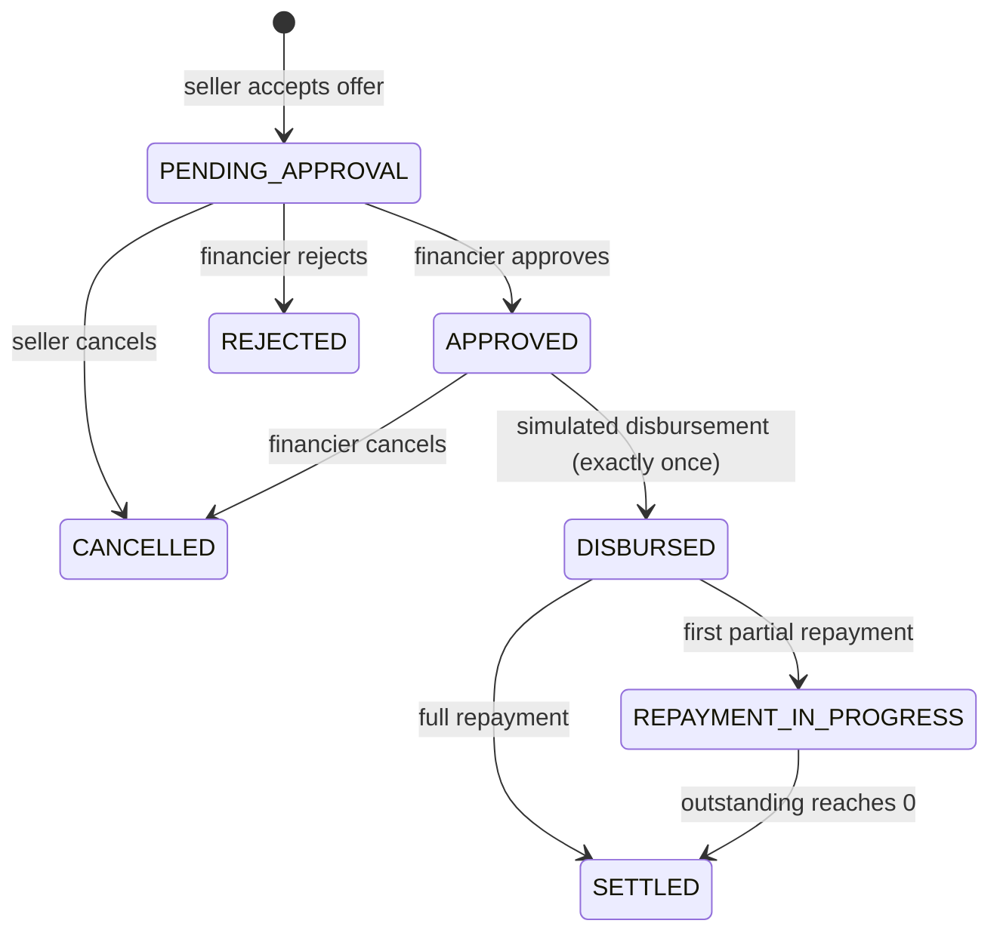
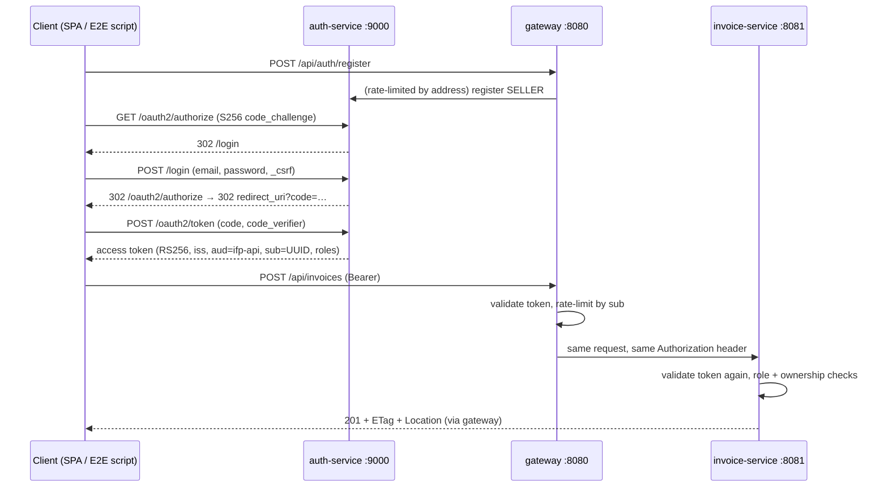

# Architecture

> Portfolio simulation of invoice financing. **No real money moves.** Disbursements and repayments are records, not bank transfers.

## 1. System context



### Communication rules

| Interaction | Style | Why |
|---|---|---|
| Browser → services | Synchronous REST through the gateway | The user is waiting for an answer |
| Service → service state changes | Asynchronous events over RabbitMQ | Services stay available when another service is down |
| Service → auth-service | JWK set fetch only (cached) | Needed to verify JWT signatures locally |

Services never call each other's REST APIs to change state, and never read another service's database.
financing-service keeps a **local read model** of financeable invoices built from invoice events (event-carried state transfer). That means it does not need to call invoice-service while a financier is making an offer.

## 2. Repository layout

```
invoice-financing-platoform/
├── pom.xml                      Maven parent (Boot 3.5.16, Spring Cloud 2025.0.3, Java 21)
├── mvnw, mvnw.cmd, .mvn/        Maven wrapper (pins Maven 3.9.9)
├── platform-common/             Thin cross-cutting library: correlation IDs (later: event envelope)
├── services/
│   ├── auth-service/            :9000
│   ├── invoice-service/         :8081
│   ├── financing-service/       :8082
│   ├── notification-service/    :8083
│   ├── audit-service/           :8084
│   └── gateway/                 :8080
├── frontend/                    Angular 21 app (Phase 6)
├── infra/mysql/init/            First-boot script: databases + least-privilege users
├── scripts/                     Dev utilities (privilege check, RSA key generation)
├── docs/                        Architecture, event contracts, decisions
├── docker-compose.yml
└── .env.example                 Placeholders only. The real .env is git-ignored
```

`platform-common` holds technical conventions only. Business rules live inside the service that owns them, so a shared library change can never silently alter another service's domain behaviour.

## 3. Data ownership

Each service has its own MySQL database and its own database user. The init script grants a user privileges on its own database only (checked by `scripts/verify-mysql-privileges.sh`). References across services are plain IDs (UUIDs) with **no cross-database foreign keys**.

| Database | Owner | Core tables |
|---|---|---|
| `auth_db` | auth-service | **Implemented (Phase 3):** `users` (email unique, case-insensitive; BCrypt hash; role; status; version) and Spring Authorization Server's `oauth2_authorization` (authorization codes and issued tokens, so codes stay single-use across restarts). The only client, `ifp-spa`, is registered in code and needs no consent screen, so there are no `oauth2_registered_client` or consent tables. **Phase 5:** `outbox_events` |
| `invoice_db` | invoice-service | **Implemented (Phase 2):** `invoices` (unique `seller_id + invoice_number`, case-insensitive; `amount DECIMAL(19,2)`; CHECK constraints for positive amount, `currency = 'INR'`, `due_date > issue_date` and valid status; `version`) and `invoice_status_history` (FK to `invoices`). **Phase 5:** `outbox_events`, `processed_events` |
| `financing_db` | financing-service | **Implemented (Phase 4):** `financeable_invoices` (read model ordered by invoice-service's row version), `financing_offers` (generated `open_financier_id` + unique `(invoice_id, open_financier_id)`: one open offer per financier per invoice), `financing_agreements` (unique `offer_id`; generated `live_invoice_id` unique so only one live agreement per invoice; CHECKs on repaid amounts and `total_repayable = advance + fee`), `disbursements` (unique `agreement_id` and `reference`), `repayment_installments` (unique `agreement_id + sequence_no`), `repayments` (CHECK `amount = principal + fee`), `repayment_allocations`, `idempotency_records` (unique `operation + actor_id + key`, SHA-256 request hash), `financing_status_history`. **Phase 5:** `outbox_events`, `processed_events`, `repayment_reminders`. **V600+:** index on `processed_events.processed_at`; penalty columns on installments, agreements, repayments and allocations (CHECKs keep `penalty_paid ≤ penalty_accrued` and `amount = principal + fee + penalty`); `penalty_accruals` (PK `installment_id + accrual_date`) |
| `notification_db` | notification-service | **Implemented (Phase 5):** `recipients` (read model from `UserRegistered`), `notifications` (unique `event_id + recipient_id`; status `SENT` or `SKIPPED`, with a CHECK that `sent_at` is set exactly for `SENT`), `delivery_attempts` (every SMTP attempt and its outcome), `processed_events` |
| `audit_db` | audit-service | **Implemented (Phase 5):** `audit_events` (unique `event_id`, sanitized JSON payload with `email` and `displayName` removed). Flyway runs as `audit_migrator`; the runtime user `audit_svc` has **SELECT/INSERT only**, so the trail is append-only at the database level |

Common conventions:

- UUID primary keys are stored as `BINARY(16)`.
- Timestamps are `DATETIME(6)` holding UTC values. The MySQL server runs with `default-time-zone=+00:00` and Hibernate uses `jdbc.time_zone=UTC`. `DATETIME` is used instead of `TIMESTAMP` to avoid session time-zone conversion and the 2038 limit.
- The application `Clock` ticks in whole microseconds. MySQL rounds sub-microsecond digits rather than truncating them, so finer timestamps would make the stored value differ from the one returned to the client.
- Calendar-date rules ("today") use the configurable business zone `Asia/Kolkata`.
- Money is `DECIMAL(19,2)` mapped to `BigDecimal`.
- Mutable aggregates have a `version` column for optimistic locking.
- Flyway owns every schema, and Hibernate runs with `ddl-auto=validate`.
- Development seed data lives in a separate Flyway location (`db/seed-dev`) that only the `dev` profile enables.

## 4. State machines

Invoice status and financing status are separate. invoice-service only learns about financing through events.

### Invoice (invoice-service)



Buyer confirmation and document verification are two explicit steps. Uploading an invoice does not prove the debt exists. In this simulation an ADMIN acts as the verification desk.

### Offer (financing-service)

`OFFERED → ACCEPTED | REJECTED (seller) | WITHDRAWN (financier) | EXPIRED (expiry passed) | CLOSED (another offer on the same invoice was accepted, or the invoice left FINANCING_AVAILABLE)`

**Multi-financier policy.** Several financiers may compete for one invoice. Each may hold at most one open offer per invoice (enforced by a unique constraint on a generated column). When the seller accepts one offer, that offer becomes `ACCEPTED`, an agreement is created in `PENDING_APPROVAL`, and every other open offer on the invoice becomes `CLOSED`, all in one transaction. Accepting and creating offers lock the invoice's read-model row, so they serialize per invoice, and the unique live-agreement constraint is the final guard against financing an invoice twice. If the agreement is later rejected or cancelled, the invoice is open for new offers again; offers already closed stay closed.

**Eligibility.** An invoice can receive offers only when its projected status is `FINANCING_AVAILABLE`, its due date is at least `financing.min-days-to-maturity` (default 7) days after today in the business zone, and it has no live agreement. If the projection later shows the invoice leaving `FINANCING_AVAILABLE` for any reason other than its own financing (`FINANCED` / `SETTLED`), open offers are closed and `PENDING_APPROVAL` / `APPROVED` agreements are cancelled. Disbursed agreements are never touched.

**Projection updates.** `InvoiceProjectionService.apply(InvoiceSnapshot)` is the only writer of `financeable_invoices`. Snapshots carry invoice-service's row version; a snapshot with a version less than or equal to the stored one is ignored, so duplicate and out-of-order deliveries cannot roll the projection back. A snapshot that changes an invoice's seller is rejected. Phase 5 feeds it from invoice events. Phase 4 has no REST endpoint for it.

### Financing agreement (financing-service)



"Overdue" is not a state. It is derived from installments whose due date has passed with an unpaid balance.

### Financial rules

All terms are chosen explicitly by the financier; the platform has no built-in or default rates. Configurable limits (`financing.*`) only bound what a financier may offer.

- **Advance:** `0 < advance ≤ invoice amount × financing.max-advance-ratio` (default 0.98), the cap rounded down to paise. The full advance is disbursed; fees are repaid, never deducted.
- **Rate:** an annual fraction with at most 4 decimals, `0 < rate ≤ financing.max-annual-rate` (default 0.36).
- **Processing fee:** flat, `0 ≤ fee < advance`.
- **Installments:** `1 … financing.max-installments` (default 12), with at least one day to maturity per installment.
- **Offer expiry:** `expiresAt` must be in the future, within `financing.max-offer-validity` (default 14 days), and before the start of the invoice due date. An expired offer is refused at accept or reject time (`OFFER_EXPIRED`), and a scheduled sweep (`financing.offer-expiry-sweep-interval`, default 60s) marks it `EXPIRED`.
- **Fee:** `advance × rate × days(disbursement date → due date) / 365`, rounded `HALF_EVEN` to paise, plus the processing fee. It is fixed at disbursement, because it depends on the days remaining. Total repayable = advance + fee.
  Example: ₹4,80,000 advance at 12% p.a. for 60 days gives a fee of ₹9,468.49; with a ₹1,000 processing fee, ₹4,90,468.49 is repayable.
- **Schedule:** principal and fee are each split into `n` equal parts rounded **down** to paise, and the last installment takes the remainder, so the parts always add up exactly. Installment `k` is due `ceil(days × k / n)` days after disbursement, so the last one is always the due date.
- **Allocation:** a repayment pays the oldest installment first; within an installment any accrued penalty is paid first, then the fee, then the principal. The split is stored in `repayment_allocations`.
- **Repayment limits:** `0 < amount ≤ outstanding` with at most 2 decimals. More than the outstanding amount is rejected (`REPAYMENT_EXCEEDS_OUTSTANDING`, 422), and any repayment after settlement is rejected (`AGREEMENT_SETTLED`, 409). The repayment that brings the outstanding amount to zero settles the agreement in the same transaction. Repayments are recorded by the seller and are simulated: no money moves.
- **Overdue:** derived per installment (`due date < today` in the business zone and something unpaid). An agreement reports `overdue`, `overdueAmount` and `nextDueDate`.
- **Penalty interest:** the repayment reminder sweep first accrues a simple daily penalty on overdue installments: `(unpaid principal + unpaid fee) × financing.penalty.daily-rate` (default 0.000500, i.e. 0.05% per day, at most 0.01), rounded `HALF_EVEN` to paise, for every day after the due date. Penalty never accrues on penalty. Missed sweep days are caught up at the current base. Each installment's total penalty is capped at `(principal due + fee due) × financing.penalty.cap-ratio` (default 0.10), rounded down. `penalty_accruals` has the primary key `(installment_id, accrual_date)`, and each agreement is accrued in its own transaction under the agreement and installment row locks (the same order repayments use), so overlapping sweeps charge each day exactly once. Repayments pay the oldest installment first and, within it, penalty, then fee, then principal. `outstanding` and the installment's `remaining` include unpaid penalty, so an agreement settles only once its penalty is paid. Disable with `financing.penalty.enabled=false`.
- **Disbursement exactly once:** the agreement must be `APPROVED`; the agreement row is locked (`SELECT … FOR UPDATE`); `disbursements.agreement_id` is unique; and an `Idempotency-Key` header is required.

### Idempotency (disbursement and repayment)

`Idempotency-Key` is required (8–100 characters of `A–Z a–z 0–9 _ -`) and scoped to the caller and operation. The business change and the `idempotency_records` row commit in one transaction.

- **First use:** `201 Created`, `Idempotent-Replayed: false`.
- **Same key and same request:** `200 OK` with the original resource and `Idempotent-Replayed: true`. Nothing new is written.
- **Same key and different request** (another agreement, or another amount): `409 IDEMPOTENCY_KEY_REUSED`.
- **Concurrent identical requests:** they serialize on the agreement row lock. The loser fails and re-reads in a new transaction, finds the winner's record, and returns it as a replay.
- **Failed operations** roll back completely, including the idempotency record, so the same key can be retried.

Repayments also lock the installment rows. Under MySQL's REPEATABLE READ, a plain read after waiting for the agreement lock could otherwise see a snapshot from before a concurrent repayment committed.

## 5. First API endpoints (via gateway `http://localhost:8080`)

| Method & path | Role | Purpose |
|---|---|---|
| `POST /api/auth/register` | public | Register a SELLER or FINANCIER (FINANCIER accounts start `PENDING_APPROVAL`; ADMIN cannot be self-registered) |
| `GET /api/users/me` | any | Current profile |
| `GET /api/admin/users` · `POST /api/admin/users/{id}/activate` | ADMIN | User management |
| `POST /api/invoices` · `PUT /api/invoices/{id}` | SELLER | Create, or edit a DRAFT |
| `GET /api/invoices?status=&page=&size=` · `GET /api/invoices/{id}` | SELLER (own) / ADMIN | List & detail |
| `POST /api/invoices/{id}/submit` · `/cancel` · `/list-for-financing` | SELLER (own) | Lifecycle |
| `POST /api/invoices/{id}/buyer-confirmation` · `/verify` · `/reject` | ADMIN | Verification desk |
| `GET /api/invoices/{id}/history` | owner / ADMIN | Status timeline |
| `GET /api/financing/opportunities?page=&size=&sort=` · `GET /api/financing/opportunities/{invoiceId}` | FINANCIER / ADMIN | Eligible invoices, with `maxAdvanceAmount` |
| `POST /api/financing/offers` · `POST /api/financing/offers/{id}/withdraw` | FINANCIER | Create / withdraw own offer |
| `GET /api/financing/offers?invoiceId=&status=` · `GET /api/financing/offers/{id}` · `/history` | SELLER (own invoices) / FINANCIER (own offers) / ADMIN | Offers |
| `POST /api/financing/offers/{id}/accept` · `/reject` | SELLER (invoice owner) | Decide on offer (accept returns the new agreement) |
| `GET /api/financing/agreements?status=` · `GET /api/financing/agreements/{id}` · `/history` | parties / ADMIN | Agreements, including outstanding, overdue and settlement status |
| `POST /api/financing/agreements/{id}/approve` · `/reject` · `/disburse` | FINANCIER (owner) | Approval & simulated disbursement (`Idempotency-Key` required) |
| `POST /api/financing/agreements/{id}/cancel` | SELLER (owner, while `PENDING_APPROVAL`) / FINANCIER (owner, while `APPROVED`) | Cancel before disbursement |
| `GET /api/financing/agreements/{id}/disbursement` · `/schedule` · `/repayments` | parties / ADMIN | Disbursement, schedule with derived installment status, repayment history |
| `POST /api/financing/agreements/{id}/repayments` | SELLER (owner) | Record simulated repayment (`Idempotency-Key` required) |
| `GET /api/notifications?page=&size=` | any (own) | Notifications sent or skipped for the caller, newest first |
| `GET /api/audit-events?eventType=&aggregateType=&aggregateId=&actorId=&from=&to=&page=&size=` | ADMIN | Read-only audit queries |

All endpoints above are **implemented** and routed by the gateway: invoices (Phase 2), auth and users (Phase 3), financing (Phase 4), notifications and audit (Phase 5). The gateway also checks the ADMIN role for `/api/audit-events` at the edge, and audit-service checks it again. Financing lists sort by whitelisted fields only (opportunities: `dueDate`, `amount`, `invoiceNumber`; offers: `createdAt`, `expiresAt`, `advanceAmount`; agreements: `createdAt`, `maturityDate`, `advanceAmount`).

Errors use RFC 9457 `application/problem+json` with a machine-readable `code`:

| Status | Meaning |
|---|---|
| 400 | Malformed or invalid input; `errors[]` lists the failing fields |
| 401 | Missing or invalid token |
| 403 | Wrong role |
| 404 | Not found, or owned by someone else (existence is not revealed) |
| 409 | Invalid status transition, duplicate invoice number, not editable, concurrent modification, duplicate open offer, invoice already financed, offer expired, idempotency key reused, agreement settled |
| 412 | `If-Match` does not match the current version |
| 422 | Business rule violated, for example `DUE_DATE_TOO_SOON` |
| 428 | `If-Match` missing on `PUT` |

Lists are paginated (`size` at most 100) and sorted only by whitelisted fields. Ownership always comes from the JWT `sub`, never from a request field. A seller-supplied `sellerId` filter is ignored.

**Concurrency contract.** Responses carry a strong `ETag` equal to the row version (for example `"3"`). `PUT` requires `If-Match`. Status-change endpoints accept an optional `If-Match`, and concurrent writers are also caught by `@Version` optimistic locking. Each status change flushes the versioned `UPDATE` before inserting its history row. The invoice row's exclusive lock is therefore taken first, and a concurrent writer fails on the version check instead of deadlocking on the history foreign key.

## 6. Event contracts

Topic exchange `ifp.events`, routing key `<aggregate>.<event>` (for example `invoice.submitted`). Envelope (schema version 1):

```json
{
  "eventId": "6f1c…",            "eventType": "InvoiceSubmitted",
  "schemaVersion": 1,             "occurredAt": "2026-10-27T10:15:30.123Z",
  "producer": "invoice-service",  "aggregateType": "INVOICE",
  "aggregateId": "b2e4…",         "actorId": "user UUID or null",
  "correlationId": "…",           "payload": { }
}
```

| Routing key → event type | Producer | Payload |
|---|---|---|
| `user.registered` → `UserRegistered` | auth | `userId`, `email`, `displayName`, `role` |
| `invoice.<created\|submitted\|buyer_confirmed\|verified\|listed_for_financing\|financed\|settled\|rejected\|cancelled>` → `Invoice<Created\|Submitted\|…>` | invoice | Invoice snapshot (IDs, number, buyer name, amount, dates, status, `previousStatus`, row `sourceVersion`); no description, rejection reason or GSTIN |
| `financing.offer_<created\|accepted\|rejected\|withdrawn\|expired\|closed>` → `FinancingOffer<…>` | financing | Offer snapshot |
| `financing.<agreement_created\|approved\|rejected\|cancelled\|disbursed\|settled>` → `FinancingAgreementCreated`, `FinancingApproved`, … | financing | Agreement snapshot; `penaltyAccrued`, `penaltyRepaid` appended |
| `financing.repayment_recorded` → `FinancingRepaymentRecorded` | financing | Repayment amount split into principal and fee, plus the agreement's resulting status; `penaltyComponent` appended |
| `financing.penalty_accrued` → `FinancingPenaltyAccrued` | financing (reminder sweep) | Agreement IDs, accrual date, daily rate, amount charged, agreement `penaltyAccrued` / `penaltyRepaid` / `penaltyOutstanding`, and per installment the days charged, base, amount and whether the cap was reached |
| `financing.repayment_<due_soon\|overdue>` → `FinancingRepaymentDueSoon`, `FinancingRepaymentOverdue` | financing (reminder sweep) | Agreement, installment number and due date; no amounts |

A null `actorId` means the system made the change (offer expiry, competing offers closed, invoice withdrawn, reminders, penalty accrual). Penalty fields are appended to existing payloads under schema version 1; consumers ignore unknown fields, so older consumers are unaffected.

**Repayment reminders.** A financing-service sweep (`financing.repayment-reminder-sweep-interval`, default 15 minutes) publishes `FinancingRepaymentDueSoon` for unpaid installments of disbursed agreements that fall due within `financing.repayment-reminder-days` (default 3), and `FinancingRepaymentOverdue` once an installment is past due. `repayment_reminders(installment_id, kind)` is written in the same transaction as the outbox row, so each reminder goes out at most once even when sweeps overlap. Settled and undisbursed agreements get none.

**Notifications.** notification-service emails the seller about invoice submission, verification, rejection, financing and settlement, new offers, approval, upcoming repayments; both parties about disbursement, overdue repayments, cancellation and settlement; the financier about acceptance, declines and repayments. Every SMTP attempt is recorded in `delivery_attempts` (`SENT`, or `FAILED` with the exception type only). Failed attempts commit in their own transaction, so the history survives the rollback that triggers the retry, and an event that exhausts its retries ends in `notification.events.dlq` with its failures on record.

| Queue | Bindings | Consumer |
|---|---|---|
| `financing.invoice-events` | `invoice.*` | financing-service feeds the `financeable_invoices` projection (version-checked) |
| `invoice.financing-events` | `financing.disbursed`, `financing.settled` | invoice-service moves the invoice to `FINANCED` / `SETTLED` as actor `SYSTEM` |
| `notification.events` | `user.registered`, `invoice.*`, `financing.*` | notification-service sends email through MailHog |
| `audit.events` | `#` | audit-service records every event |

Events carry IDs, amounts, dates and statuses, and never passwords or tokens. `UserRegistered` is the only event with an email address and display name: notification-service needs them for its recipient directory, and audit-service strips both before storing. Notification emails never contain amounts.

Reliability:

- **Outbox (`platform-messaging`):** the business row and its outbox row are written in one local transaction; `OutboxWriter` refuses to run without one. A relay polls pending rows with `FOR UPDATE SKIP LOCKED` in write order (`seq`), publishes them with publisher confirms, and marks them published only after the broker acks. A failed publish is retried with exponential backoff (2 s, 4 s, 8 s, … capped at 5 minutes). Delivery is at-least-once.
- **Outbox retention:** in every service that runs the relay (auth, invoice, financing), `OutboxPurger` deletes published rows older than `ifp.messaging.purge.retention` (default 7 days) every `ifp.messaging.purge.interval` (default 1 hour), in batches of 1,000 in `seq` order. Unpublished rows are never purged. To replay older events (see projection rebuild below), raise the retention first.
- **Broker objects:** exchanges and queues are durable, and messages are published persistent with the event ID as AMQP `message-id`. Listener containers acknowledge a message only after the handler and its database transaction have committed (Spring AMQP `AUTO` acknowledgement, which uses broker-level manual acks), and reject it otherwise.
- **Unroutable events** are not lost: `ifp.events` has the alternate exchange `ifp.events.unrouted`, whose queue parks them for inspection.
- **Idempotent consumers:** `processed_events(consumer, event_id)` is inserted in the same transaction as the business effect. A duplicate delivery hits the primary key, rolls back and is acknowledged without effect. audit-service relies on its unique `event_id` instead.
- **`processed_events` retention:** in every service with the table, `ProcessedEventsPurger` deletes rows older than `ifp.messaging.processed-events.retention-days` (default 30) every `ifp.messaging.processed-events.interval` (default 1 hour), in batches of `batch-size` (default 1,000) by primary key, logging each run and counting `ifp.messaging.processed.events.purged` (failures: `ifp.messaging.processed.events.purge.failures`). A duplicate arriving after its row was purged would be applied again, so keep the window well beyond the outbox retention and any redelivery or replay you might perform. Disable with `ifp.messaging.processed-events.enabled=false`.
- **Retry and DLQ (delayed retry queues):** a queue declared with `EventTopology.consumerQueueWithRetries` (currently `financing.invoice-events`) gets three tier queues, `<queue>.retry.10s`, `<queue>.retry.1m` and `<queue>.retry.10m`. Each tier has a message TTL and dead-letters back through the direct exchange `ifp.events.retry` to `<queue>`. When the handler fails, the listener republishes the message (with publisher confirm) to the next tier with header `x-ifp-retry-count` incremented, and acknowledges the original, so no consumer thread waits during the delay. After the third retry fails, or if the retry cannot be published, the message is rejected without requeue to `<queue>.dlq` through `ifp.events.dlx`. Malformed envelopes, unknown schema versions and business-invalid events (for example a disbursement for an invoice that is not listed) skip the tiers and go to the DLQ immediately. Metrics: `ifp.messaging.retry.scheduled` (tags `queue`, `tier`) and `ifp.messaging.retry.exhausted`. Queues still declared with `consumerQueue` (invoice, notification and audit) keep the in-listener retry: 4 attempts with 1 s, 2 s, 4 s backoff, capped at 10 s, then the DLQ.
- **Inspection:** queue depths and message bodies are visible in the management UI (http://localhost:15672 → Queues → `<queue>.dlq` → Get messages, with "Ack mode: Nack message requeue true" so inspecting does not remove them). Bodies contain IDs, statuses and amounts but no credentials.
- **Replay:** after fixing the cause, move messages from `<queue>.dlq` straight to the consumer's own queue `<queue>` with the management UI's "Move messages" action (needs the `rabbitmq_shovel` and `rabbitmq_shovel_management` plugins) or a dynamic shovel. Do not move them to `ifp.events`: that would redeliver the event to every bound consumer. A dead-lettered message from a tiered queue keeps `x-ifp-retry-count = 3`, so a moved message gets exactly one more attempt and returns to the DLQ if it fails again. To give it the full retry ladder, republish it to `<queue>` without that header (for example via "Publish message" on the queue page, copying the body and properties). Consumers are idempotent, so replaying an already-applied event is harmless, as long as its `processed_events` row is still within the retention window.
- **Queues exist once a consumer has started.** Each service declares its own queue on startup. Events published before a consumer's first start are not lost but parked in `ifp.events.unrouted`, and can be moved back to `ifp.events` the same way.
- **Projection rebuild / reconciliation:** the financing read model can be re-fed from invoice-service's outbox. Stop financing-service, delete its `processed_events` rows for consumer `financing-service.invoice-projection`, set `published_at = NULL, next_attempt_at = NOW(6)` on the invoice-service `outbox_events` rows to replay, then start financing-service. The relay republishes them in order, and the projection's version check applies only snapshots newer than what it holds. Other consumers skip the replayed event IDs (their `processed_events` rows remain), so no emails or audit rows are duplicated.
- **Ordering:** events from one producer are published in write order, but there is no ordering across producers or across retries. Consumers therefore compare versions (projection) or check the current status (invoice outcome; a settlement that overtakes its disbursement applies both steps).
- Exactly-once delivery across services is **not** claimed. A crash between sending an email and committing can resend that email.

### V700 backend additions (supersede the statements above where they differ)

- **`user.rejected` → `UserRejected`** (auth, actor = the admin): payload `userId`, `role`, `reason` (optional, at most 500 characters). Written to the outbox by `POST /api/admin/users/{id}/reject`, which only accepts `PENDING_APPROVAL` accounts. `REJECTED` is terminal: such an account cannot sign in, obtain tokens or be activated. audit-service records the event through its `#` binding. notification-service does not bind `user.rejected`, so no email is sent.
- **Delayed retries on every consumer queue:** `invoice.financing-events`, `notification.events` and `audit.events` are now declared with `consumerQueueWithRetries`, like `financing.invoice-events`, and no service uses in-listener retry any more. Each has `<queue>.retry.10s`, `.retry.1m` and `.retry.10m` tiers. The main queue and `<queue>.dlq` keep their previous arguments, so existing broker volumes accept the new declarations. The replay procedure above, including `x-ifp-retry-count`, now applies to all four queues. notification and audit publish retry copies with publisher confirms. A notification whose SMTP send keeps failing is now attempted 4 times over about 11 minutes (immediately, then after 10 s, 1 min and 10 min) before it reaches `notification.events.dlq`. Before this change, the 4 attempts happened within about 7 s.
- **`processed_events.processed_at` index** (`ix_processed_events_processed_at`) now exists in invoice_db (V700) and notification_db (V701) as well as financing_db.
- **Notification read state** (notification_db V700, `read_at`): `POST /api/notifications/{id}/read` (idempotent; 404 for an unknown or another user's notification), `POST /api/notifications/read-all` (returns `markedRead`) and `GET /api/notifications/unread-count`. All three act on the token subject only. List items append `readAt`.

## 7. Security decisions

| Topic | Decision |
|---|---|
| Login | Angular is a **public OAuth2 client** using Authorization Code + PKCE against auth-service. The login form is served by auth-service, so the SPA never handles passwords. |
| Tokens | RS256 JWT access tokens, 15 min (configurable), with `iss` and `aud=ifp-api` validated by the gateway **and** by every service (defense in depth). The SPA keeps tokens **in memory**, not localStorage. |
| SPA session | The SPA checks that the discovery document's issuer matches its configuration and that the authorization and token endpoints are on the issuer's origin. It keeps only `state`, `nonce`, the PKCE verifier and the return path in `sessionStorage` while the browser is at auth-service, and deletes them as soon as the callback arrives. It checks `state`, then the ID token's `iss`, `aud`, `nonce` and `exp` (received directly from the token endpoint, so OIDC Core 3.1.3.7 lets TLS stand in for the signature), and reads the user ID, name and role from it. The access token is attached only to `<apiBaseUrl>/api/**`. There are no refresh tokens, so the session ends 30 s before the access token expires. A reload also drops the in-memory token, and the next guarded page goes back through auth-service, whose own session skips the password. Sign-out uses RP-initiated logout (`id_token_hint`), which ends the auth-service session too. Route guards and role-based navigation only shape the UI; the APIs enforce access. |
| Token contract | `sub` = user UUID (tokens with any other subject are rejected with 401). `roles` = array of `SELLER`/`FINANCIER`/`ADMIN`, mapped to `ROLE_*` authorities; unknown roles grant nothing. `aud` must contain `ifp-api`. Only RS256 is accepted. auth-service must issue exactly this shape in Phase 3. |
| Implementation status | **Phase 3:** auth-service issues exactly this token shape and re-reads role and status from the database at issuance; the gateway validates it at the edge; invoice-service still validates signature, issuer, audience, expiry and algorithm itself and applies `@PreAuthorize` role checks plus service-layer ownership checks. The gateway is not the only security boundary: calling invoice-service directly with an invalid token is rejected too (checked by the end-to-end script). |
| Issuer in Docker | Issuer is fixed to the browser-visible URL (`http://localhost:9000`). Services fetch keys from the internal `jwk-set-uri` (`http://auth-service:9000/oauth2/jwks`) and validate the issuer string explicitly. |
| Keys | `scripts/generate-dev-jwt-key.ps1` / `.sh` writes an RSA-3072 PKCS#8 key into the git-ignored `infra/keys/`. Private keys are never committed. auth-service refuses to start without a key file; an in-memory ephemeral key is allowed only when the `dev` profile (or a test) sets `auth.jwt.allow-ephemeral-key=true`. The `kid` is the RFC 7638 thumbprint, and retired public keys can stay published during rotation. |
| CSRF | Disabled for stateless bearer-token APIs (no auth cookies). Enabled on the auth-service login form, which is session-based. |
| CORS | Explicit origins, methods and headers from configuration (default origin `http://localhost:4200`), applied at the gateway on `/api/**`. Credentials are not allowed (tokens travel in a header, not cookies), and a `*` origin fails startup validation. auth-service has its own CORS list, but only for the endpoints the browser calls directly (`/oauth2/**`, `/.well-known/**`, `/userinfo`). Its `/api/**` is reached through the gateway and sends no CORS headers. The gateway also keeps only its own copy of each CORS response header (`DedupeResponseHeader`), because browsers reject a response that carries two `Access-Control-Allow-Origin` values. |
| Passwords | `DelegatingPasswordEncoder` (BCrypt by default). |
| Authorization | Role checks plus ownership checks in the service layer. Hiding UI buttons is never relied on. |
| Rate limiting | Gateway `RequestRateLimiter` with Redis token buckets, keyed by validated JWT subject (or a hashed client address when unauthenticated), with an explicit per-route failure mode. See [Gateway](#gateway). |
| Login throttling | auth-service limits `POST /login` and `POST /oauth2/token` to 30 requests per client address per minute each. Five failed logins for one username from one address within 15 minutes lock that pair out for 5 minutes, even for the correct password, and unknown usernames count as failures. Locking the pair rather than the account means an attacker cannot lock a victim out from elsewhere. Counters live in Redis under SHA-256 keys (no readable address or email), the filter runs before CSRF and authentication and answers 429 with `Retry-After`, and it fails open if Redis is unavailable. The client address is the TCP peer: `X-Forwarded-For` is ignored because it is client-controlled. |
| Logging | JSON (ECS) on stdout by default, with `service.name` and the MDC `correlationId`; the `local` profile switches to readable lines. Authorization headers, tokens, passwords, emails, amounts and account numbers are never logged. |
| Health | `/actuator/health/liveness` (process state only) and `/actuator/health/readiness` (also the service's database) are public on every service for container healthchecks. RabbitMQ and Redis are excluded, because the outbox and the rate-limit failure modes already cover their outages. |

### Gateway

The gateway (Spring Cloud Gateway, reactive) holds no business logic. Each request passes through, in order:

1. **Correlation ID** (`CorrelationIdWebFilter`, first filter). A valid `X-Correlation-Id` (8–64 chars of `[A-Za-z0-9._-]`) is kept; anything else is **replaced** with a fresh UUID, never forwarded. The ID is set on the forwarded request and on every response, including 401/403/429.
2. **Spring Security** (`SecurityConfig`), stateless: no session, no request cache, and CSRF, form login and basic auth disabled.

   | Path | Rule |
   |---|---|
   | `/actuator/health/**`, `/actuator/info` | public |
   | `POST /api/auth/register` | public |
   | `/api/admin/**` | `ROLE_ADMIN` |
   | `/api/**` | any valid token |
   | anything else | denied |

   Tokens are decoded by a `NimbusReactiveJwtDecoder`:
   - RS256 only, with keys from `AUTH_JWK_SET_URI`.
   - The issuer, audience, required `exp` and UUID `sub` are all validated.
   - An unknown `kid` triggers a JWK set refetch, so a newly published key is accepted without a restart (key rotation).

   401 and 403 responses are fixed `application/problem+json` bodies; they never include the token, key IDs or the validation failure reason.
3. **CORS** is checked by Spring Security for `/api/**` with the configured explicit lists. A disallowed origin gets 403 before routing.
4. **Routing and rate limiting.**

   | Route | Target | Limiter |
   |---|---|---|
   | `POST /api/auth/register` | auth-service | `publicRateLimiter` |
   | `/api/users/**`, `/api/admin/users/**` | auth-service | `apiRateLimiter` |
   | `/api/invoices/**` | invoice-service | `apiRateLimiter` |

   The original `Authorization` header is forwarded unchanged. The gateway adds **no** identity headers (`X-User-Id` etc.). Downstream services authenticate the token themselves and never trust headers set by the edge.
5. **Errors** (`GatewayErrorHandler`). Downstream error responses pass through unchanged. Failures to reach a service map to fixed problem bodies without hosts, ports or exception text:
   - connection refused or unknown host: 503 `DOWNSTREAM_UNAVAILABLE`
   - response timeout (default 10 s): 504 `DOWNSTREAM_TIMEOUT`
   - no route: 404
   - anything else: 500

The OAuth2/OIDC endpoints (`/oauth2/*`, `/login`, `/.well-known/*`, `/oauth2/jwks`) are served by auth-service at the issuer URL and are **not** routed through the gateway. The issuer must be one stable browser-visible URL, and the login page's session cookie and CSRF token belong to that origin.

#### Rate-limiting policy

Spring Cloud Gateway's token-bucket Lua script runs atomically in Redis. Each route's limits come from configuration (`RATE_LIMIT_*` environment variables):

| Limiter | Key | Default | If Redis is unavailable |
|---|---|---|---|
| `publicRateLimiter` (registration) | `ip:<first 128 bits of SHA-256(client address)>` | bursts of 5, then 5/min | **FAIL_CLOSED**: 429 |
| `apiRateLimiter` (authenticated APIs) | `user:<validated token sub>` | bursts of 40, then 20/s | **FAIL_OPEN**: request continues with `X-RateLimit-Unavailable: true` |

- **Keys never contain raw tokens or raw IP addresses.** The user key is the validated subject, so a user cannot escape their bucket by fetching new tokens. The client address is the TCP peer. `X-Forwarded-For` is honoured only for `GATEWAY_TRUSTED_PROXY_HOPS` trusted proxies (default 0), so clients cannot choose their own bucket. Hashing addresses is pseudonymisation, not anonymisation; keys expire with the bucket.
- **Why different failure modes.** The stock `RedisRateLimiter` silently allows all traffic when Redis fails. Here the choice is explicit per route:
  - Registration is unauthenticated and abuse-prone, so a Redis outage must not remove its only throttle.
  - Authenticated API calls have already passed full token validation, and the services still enforce roles and ownership. Failing open there means a Redis outage removes throttling but **never authentication or authorization**. It does not take down the authenticated product.
  - Unauthenticated requests to protected APIs are rejected by security before any limiter runs.
- A Redis call is bounded by `gateway.rate-limit.redis-timeout` (default 750 ms), after which the failure mode applies. The gateway's health check does not include Redis, so an outage does not fail liveness probes.
- Exceeding a limit returns 429. Allowed responses carry `X-RateLimit-Remaining`.

#### End-to-end flow (verified by `scripts/e2e.ps1`)



The script also checks the negative paths:
- another seller gets 404 for the invoice;
- a seller gets 403 on admin operations (from invoice-service) and on admin user APIs (at the gateway);
- a pending financier cannot sign in;
- requests without PKCE, or with the wrong verifier, are refused;
- missing, garbage, tampered and `alg=none` tokens get 401 from both the gateway and invoice-service directly.

## 8. Trade-offs

- **Microservices vs modular monolith:** six deployables add operational cost (more containers, eventual consistency, distributed debugging). They are used here to demonstrate service boundaries and reliable messaging. A real early-stage product would likely start as a modular monolith.
- **Eventual consistency:** invoice status updates to `FINANCED` a moment after disbursement. The UI shows the financing-service view as the source of truth for money.
- **Shared MySQL server:** separate databases and users enforce ownership, but one server is a shared failure domain. That is acceptable locally, and production would separate them.
- **Delayed retries are opt-in per queue.** financing-service uses the delayed retry tiers. invoice, notification and audit services still use in-listener retries, which block a consumer thread during backoff, until their queues switch to `consumerQueueWithRetries` and disable `spring.rabbitmq.listener.simple.retry`. Each tier uses a queue-level TTL, so messages expire in arrival order without head-of-line blocking. Changing a tier's delay means declaring a new queue, because RabbitMQ refuses to redeclare a queue with different arguments.
- **Events start at Phase 5.** The dev seed invoices and anything created before Phase 5 have no outbox rows, so they never reach the financing projection, notifications or the audit trail. Users registered before Phase 5 (including a bootstrapped admin) are unknown to notification-service, and their notifications are recorded as `SKIPPED` with `RECIPIENT_UNKNOWN`.
- **`processed_events` retention trades dedup horizon for table size.** Rows are purged after 30 days, so a duplicate older than that would be applied again. Only financing_db has the `processed_at` index; elsewhere the purge scans the table (the delete itself is by primary key).
- **Penalty interest is simple and uses the current base for catch-up days.** If the sweep misses days, they are charged at the unpaid amount at catch-up time, not as it was on each day. The default rate and cap are placeholders that need business sign-off.
- **Correlation IDs are replaced, not rejected.** A malformed `X-Correlation-Id` gets a fresh UUID instead of a 400. Tracing is best-effort metadata, the malformed value is never forwarded or logged, and this matches the behaviour every service already has through `platform-common`.
- **Login throttling fails open and trusts the TCP peer address.** A Redis outage removes the throttle (BCrypt cost and the 12-character minimum remain). Behind a NAT or a proxy that does not preserve source addresses, many users share one address and therefore one per-address budget. A distributed guessing attack from many addresses is limited only by the per-pair lockout.
- **The gateway's JSON log lines carry `correlationId` only on its own error paths.** Reactor does not propagate the MDC, so the gateway sets it explicitly in its error handler. Its "rate limiter unavailable" warning, startup lines and framework lines have no correlation ID. In the servlet services, startup and scheduler lines have none either.
- **Unknown-`kid` refetch.** A token with an unseen key ID makes the gateway and services refetch the JWK set. That is what makes rotation seamless, but a flood of forged tokens could amplify load on `/oauth2/jwks`. Nimbus caches the set, and production would put the JWK endpoint behind a cache or CDN.
- **Fail-open API rate limiting** trades abuse protection for availability during a Redis outage. Authentication and authorization still apply, and registration fails closed.
- **MailHog** has been unmaintained since 2020. It is used because it was specified, and Mailpit is a drop-in alternative.
- **Flyway 11.7.2**, the version Spring Boot 3.5.16 manages, logs "upgrade recommended" for MySQL 8.4 because it was not tested against that version. Migrations are verified against MySQL 8.4 by the integration tests. The Spring Boot-managed version is kept rather than overridden.
- **Mockito agent JVM notice:** tests load Mockito with `-javaagent`, which is the setup Mockito documents now that runtime self-attach is deprecated (JEP 451). This removes the self-attach warnings. Each test JVM still prints "Sharing is only supported for boot loader classes because bootstrap classpath has been appended". That notice comes from class-data sharing (CDS) and is harmless. It is not hidden with `-Xshare:off`, which would only slow test startup.

### Known gaps

- **Financier rejection:** auth-service has no endpoint to decline or disable an account (only `GET /api/admin/users` and `POST /api/admin/users/{id}/activate`), so the admin console can approve financiers but not reject them.
- **Notification read state:** notification-service stores no read/unread state and has no mark-as-read endpoint, so the app cannot mark notifications as read.
- **Header "new" count:** the notification count in the app header is derived from a per-device `localStorage` timestamp of the newest notification the user has seen, not from server state. It does not sync across browsers or devices.

### Known gaps (financier UI)

- **No opportunity filters.** `GET /api/financing/opportunities` supports only sorting and paging, so the list offers nothing more.
- **No reject or cancel agreement actions.** financing-service allows them, but the UI offers only approve and disburse for now.
- **The financier-specific 403 message appears only for actions.** The core auth interceptor sends any `403` on a page load to the shared no-access page, so only refused actions (offer, withdraw, approve, disburse) explain that new financiers need an administrator's approval.
- **The disbursement `Idempotency-Key` is kept in memory only.** A retry on the same page reuses it, but a full page reload creates a new key. That is safe because the reloaded page shows the agreement's current status and offers disbursement only while it is still approved.

## 9. Roadmap

| Phase | Scope | Depends on |
|---|---|---|
| 1 Foundation ✅ | Repo config, Compose infra (MySQL, RabbitMQ, Redis, MailHog), DB isolation, service skeletons, correlation IDs | — |
| 2 Invoices ✅ | invoice-service domain, Flyway, state machine, REST, ETag/If-Match, dev-only seed data, **JWT validation and role/ownership authorization for invoice-service**, unit + Testcontainers ITs | 1 |
| 3 Auth & gateway ✅ | auth-service (Authorization Server, users, registration, RSA key management, token contract above), gateway routes/token validation/CORS/rate limit/correlation IDs, negative authz tests, repeatable end-to-end script. Resource-server config for financing/notification/audit lands with those services (Phases 4–5) | 1, 2 |
| 4 Financing ✅ | Read model, offers, agreements, disbursement idempotency, schedules, repayments, settlement, concurrency tests, gateway route | 3 |
| 5 Events ✅ | Outbox in auth/invoice/financing, consumers, notification & audit services, retries/DLQ, duplicate-delivery tests | 2–4 |
| 6 Frontend (in progress) | Angular 21 seller/financier/admin workflows against real APIs (Angular 19 was planned; it is end-of-life with unpatched advisories). Done: app shell, themes, Authorization Code + PKCE sign-in, role guards and API token handling, seller/financier registration, seller invoices (list, create, details, draft edit, cancel, submit and list for financing with `If-Match`), seller financing (accept or reject offers; agreement, disbursement, schedule with penalties, and idempotent repayments), the admin console (invoice queue with buyer confirmation, verification and rejection with `If-Match`, financier approval, read-only audit log), notifications for all roles with a per-device "new" count, and the financier workflow (opportunities, offers, agreement approval, idempotent disbursement, repayment schedule) | 3–5 |
| 7 Containers & CI ✅ | Dockerfiles (multi-stage, non-root, healthchecks), full Compose behind the `app` profile with health ordering and a one-shot dev signing-key volume, GitHub Actions (Maven verify, frontend checks, mocked and full-stack E2E, image build with Trivy, SBOMs and GHCR push), Dependabot | 1–6 (images cover the frontend as it stands) |
| 8 Verification | End-to-end run, security pass, final docs | all |

**Known gaps (containers & CI)**
- The live Playwright job in `ci.yml` has not yet run against the Compose stack; its first CI run is its first real check.
- Netty logs a startup warning because `/tmp` is mounted `noexec`; it cannot load its native transport and falls back to standard Java networking, which works.
- On a heavily loaded host, slow startups can exceed the healthcheck budgets, so a second `docker compose --profile app up -d --wait` may be needed.
